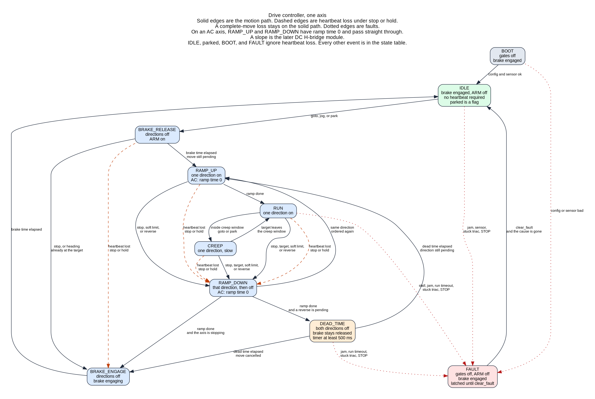

# Drive controller

Design proposal, 2026-10-17. The decision record is [ADR 0020](../decisions/0020-drive-controller.md), status Proposed. This note does not change the schematic or the firmware.

The board gains a second MCU, the Drive. It is the virtual rotator: a short command interface, every deadline, and the same behavior when the STM32F407 is off, busy, or in the middle of an update. The F407 becomes the Station. It keeps the web UI, USB, Ethernet, GS-232, Hamlib, Easycom, the operator preset catalog, logging, parking schedules, multi-rotator, and firmware updates for both chips.

The principle for the split is: deadlines live in the Drive.

Owner decisions recorded against the first draft: the names Drive and Station; an AC axis is on or off, so its ramp time is 0; K1 stays, one ARM relay on the first board, because it is the only way to take a shorted triac off the bus; TR1, the ZMCT103C, stays as drawn. The heartbeat default, the residual-hardware choice, and the Drive MCU part are still open. Section 8 is that list.

## 1. Names

**Drive** is the new MCU. **Station** is the STM32F407.

| Name | Chip | The word covers |
| --- | --- | --- |
| Drive | the new MCU | motors, sensing, brakes, and every deadline |
| Station | STM32F407VGT6, the chip in ADR 0014 | web UI, USB, Ethernet, operator protocols, logging, schedules, multi-rotator, updates |

The product is already called the rotator controller. Drive is the chip that fires the triacs, times the reversal, and still holds the limits when the Station is down. Station is the chip that faces the shack.

## 2. Who owns what

Deadlines live in the Drive. A deadline here means a time after which the hardware must already have done something: dead time before a reverse, ramp, brake release and engage, soft-limit stop, stall, jam, run timeout, and the heartbeat. The Station may be occupied with Ethernet, USB, the web UI, or a firmware upgrade. Those tasks do not extend a Drive deadline.

| Work | Drive | Station |
| --- | --- | --- |
| CW, CCW, and brake triac gates; ARM relay | owns | |
| Reversal dead time | owns | |
| Ramp states. AC ramp time is 0, so the axis is on or off. A real slope is the later DC H-bridge module (ADR 0018). | owns the states | |
| Soft limits and the overlap choice | owns | displays |
| Stall, jam, run timeout | owns | displays and logs |
| Position: pot ADC, filtering, calibration, pulse and quadrature inputs | owns | displays |
| Goto, jog, stop, and park execution | owns | translates GS-232, Hamlib, Easycom, and the web UI into those commands |
| Heartbeat and the loss policy | enforces | sends |
| Limits, calibration, park heading, ramps, deadlines, loss policy | flash copy that runs | operator copy and the preset catalog |
| The other chip off or wedged | runs the stored config and the loss policy | can reset and reflash the Drive; does not gate the triacs |
| Web UI, USB, Ethernet | | owns |
| GS-232, Hamlib, Easycom | | owns |
| Logging, parking schedules, multi-rotator | | owns |
| Firmware update | receives its image over the link | owns both updates |

Azimuth and elevation are two instances of one state machine. Elevation adds a second instance and, when the rotor needs it, a second power stage. ADR 0008 stays: an azimuth-only board leaves the elevation power stage unpopulated. The elevation machine stays in IDLE and reports itself absent.

One Drive serves one rotator (one or two axes) on one UART. A second rotator is a second Drive and a second UART on the Station. That is how multi-rotator stays a Station concern.

## 3. Link to the Station

### Physical layer

Both MCUs use the rotor-return ground. ADR 0018 set logic ground to CDE terminal 1 and left no isolated DC-DC between logic chips. USB stays isolated by the ADuM4160. Ethernet stays isolated by the MagJack. The Drive-to-Station link is on that same ground: 3.3 V, no isolator, no level shifter.

That ground is also the motor return. The link is a short trace, with the two chips placed near each other.

| Link | Wires | Fit |
| --- | --- | --- |
| UART | TX, RX, and the shared ground | Recommended. Either chip can send a status frame. A ground bounce corrupts a byte, and the CRC drops that frame. |
| SPI | SCK, MOSI, MISO, CS | Workable on a short board. Two extra wires, and a clocked transfer is an easy place to start streaming motion samples. The commands in this note are targets with an acknowledgement. |
| I2C | SCL, SDA | A poor fit on a motor return. A spike becomes an extra clock, and the protocol has no frame CRC. |

Assumption: 115200 baud, 8 data bits, no parity, one stop bit, using the MCU's internal oscillator. A crystal is optional; none is required for this baud on a short link.

### Frame

Proposed version 1:

| Field | Bytes | Contents |
| --- | --- | --- |
| SOF | 1 | `0xA5` |
| VER | 1 | `0x01` |
| SEQ | 1 | Host command sequence. Unsolicited status uses `0`. |
| OPCODE | 1 | Below. |
| LEN | 1 | Payload length, 0 to 128. |
| PAYLOAD | LEN | |
| CRC | 2 | CRC-16/CCITT-FALSE, polynomial `0x1021`, init `0xFFFF`, over VER through the payload, high byte first. |

Assumption: that CRC. A damaged frame is dropped with no reply, because the SEQ byte may be the damaged one.

### Sequence numbers

The Station sends one command and waits for the ACK of that SEQ. A retry repeats the same SEQ. The Station sends the next SEQ only after that ACK, and it retries only the SEQ it is waiting on.

The Drive stores `last_seq`. After reset, `last_seq` is 0 and the first CRC-good command may carry any non-zero SEQ. That value becomes `last_seq`.

Later frames:

- `SEQ == last_seq`: duplicate. ACK, and leave the payload unapplied.
- `SEQ == last_seq + 1` modulo 256, skipping 0: apply, then store it.
- any other SEQ: NACK `BAD_SEQ`. Leave the state and `last_seq` alone. The frame is not a heartbeat.

Unsolicited status uses SEQ 0 and stands outside that counter.

A lost command is retried under the same SEQ and applied once. A duplicate is acknowledged and applied once. After a newer SEQ has been accepted, an older SEQ is `BAD_SEQ` and cannot replace the newer target.

Each command names a target. GOTO replaces the heading. JOG replaces the direction and the speed. STOP replaces the goal with stopped. A late, repeated, or missing copy leaves the Drive on the last accepted target. The Drive does not integrate steps.

### Order inside a good frame

1. Apply the SEQ rules above.
2. HEARTBEAT, READ_STATUS, or any command while `host_lost` is clear: apply `heartbeat_ok` first.
3. A motion or config command while `host_lost` is set: NACK `HOST_LOST`. That frame does not clear the flag.
4. Otherwise apply the opcode as the event in the state table.

On a live link, a command refreshes the heartbeat. After a loss, only HEARTBEAT or READ_STATUS clears `host_lost`. The following command is then accepted. That is the "ignore new commands until the heartbeat returns" rule.

### Command set

Proposed opcodes:

| Opcode | Code | Payload |
| --- | --- | --- |
| HEARTBEAT | `0x01` | empty |
| GOTO | `0x02` | axis mask, azimuth in 0.01°, elevation in 0.01°, each a signed 32-bit value |
| STOP | `0x03` | axis mask |
| JOG | `0x04` | one axis bit, direction, speed in permille (`uint16`, 0–1000) |
| PARK | `0x05` | axis mask. The heading is the park value in Drive flash. |
| SET_LIMITS | `0x06` | axis, minimum, maximum, overlap flag |
| SET_CALIBRATION | `0x07` | axis, sensor kind, end readings, end headings. Byte layout TBD. |
| SET_PRESET | `0x08` | axis, park heading |
| SET_MOTION | `0x09` | ramp time (0 on an AC axis), creep window, target window, dead time, brake times, stall, jam, run timeout, heartbeat, loss policy |
| READ_STATUS | `0x0A` | empty. The ACK carries the status record. |
| CLEAR_FAULT | `0x0B` | axis mask |
| ENTER_BOOTLOADER | `0x0C` | a 32-bit magic. The constant is TBD, so a damaged payload cannot enter the bootloader. |
| STATUS | `0x10` | unsolicited status, SEQ 0 |
| ACK | `0x80` | echoes SEQ |
| NACK | `0x7F` | echoes SEQ and a reason byte |

NACK reasons: `BAD_SEQ`, `BAD_STATE`, `HOST_LOST`, `LIMIT`, `BAD_CONFIG`, `FAULT`, `AXIS_ABSENT`, `BAD_MAGIC`.

An AC axis is on or off. Its ramp time is 0, and CREEP commands the same full-on direction gate as RUN. Permille speed and a non-zero ramp belong to the later DC H-bridge module. The states in section 4 still run, and on AC the ramp states pass straight through. Heading unit and the permille encoding are still open (section 8).

Axis bit 0 is azimuth. Bit 1 is elevation.

`SET_LIMITS`, `SET_CALIBRATION`, `SET_PRESET`, and `SET_MOTION` are one event in the state table, `cmd_set_config`. They stay separate opcodes on the wire. A valid write replaces those fields and updates the config CRC. A duplicate SEQ does not write flash again.

### Status

READ_STATUS returns the record below. The Drive also sends it unsolicited. Assumption: every 100 ms while any axis has a heartbeat armed, and every 1 s in BOOT, IDLE, and FAULT.

Per axis: state, parked flag, direction, heading and a valid flag, target, held target (set when hold-on-loss abandons a goto), speed, dead time remaining, brake time remaining, ramp time remaining, CW and CCW limit flags, fault bits, `host_lost`, the loss policy, and a present flag.

Shared: current-transformer reading as raw ADC counts and as milliamps using the burden equation; config CRC-32; firmware major, minor, patch, and build id; protocol version; `last_seq`; the sampled supervisor reset line.

DESIGN-NOTES already flags CT saturation at motor-plus-brake current. The milliamp field inherits that limit.

### Faults and flags

Latched fault bits. `clear_fault` clears a bit only when its cause is gone, and the axis stays in FAULT while any bit remains.

| Bit | When it sets |
| --- | --- |
| `CONFIG` | The stored config fails its check. |
| `STALL` | A direction gate is on and the heading stays inside the stall window for the stall time. A low-current detector can set the same bit. Thresholds TBD. |
| `JAM` | Current above the jam threshold. |
| `RUN_TIMEOUT` | This move has exceeded the configured maximum run. |
| `SENSOR` | The pot sample is outside the calibrated range, or the pulse input fails its check. |
| `STUCK_TRIAC` | Stuck-on sense says that triac is conducting after its gate has been off for 20 ms. That interval is the one already in DESIGN-NOTES. |
| `STOP` | The STOP input is sampled while the core is running. |
| `BOTH_ON` | The output step was asked for CW and CCW together. The state table does not ask for that. The check is defensive. |

`STUCK_TRIAC`, `JAM`, `SENSOR`, `STOP`, `CONFIG`, `STALL`, `RUN_TIMEOUT`, and `BOTH_ON` force the safe outputs in the same tick: both direction gates off, brake engaged, ARM relay open. They do not ramp down. Opening the ARM relay takes a shorted triac off the 26 VAC bus.

Flags, which are not faults: `HOST_LOST`, the two soft-limit flags, and `PARKED`.

## 4. Heartbeat and the axis machine

The host heartbeat is a deadline of seconds. It is a different timer from the TPS3823, which the Drive kicks faster than 0.9 s, and from the Drive's independent watchdog.

Proposed host timeout: 5 seconds, set per rotor, allowed range 2 to 30 seconds. Proposed default loss policy: stop.

The deadline arms when a move is accepted and disarms on entry to IDLE. An idle axis and a parked axis have no heartbeat deadline.

| Policy | Result of a missed heartbeat |
| --- | --- |
| stop | Leave the direction through `RAMP_DOWN` (immediate when the ramp time is 0), engage the brake, enter IDLE, set `host_lost`, and drop the goal. |
| hold | The same motion as stop. The abandoned heading stays in `held_target` for the Station to display. The axis does not continue. |
| complete | The goto or park already underway runs to IDLE. New commands wait for `heartbeat_ok`. A jog has no target, so a jog takes the stop path. |

### Outputs

Brake gate high means the solenoid releases the wedge, matching DESIGN-NOTES. Gate low means the wedge is engaged.

| State | Direction gates | Brake | ARM relay |
| --- | --- | --- | --- |
| BOOT | off | engaged | off |
| IDLE | off | engaged | off |
| BRAKE_RELEASE | off | releasing | on |
| RAMP_UP | one direction | released | on |
| RUN | one direction | released | on |
| CREEP | one direction | released | on |
| RAMP_DOWN | that same direction until `ramp_done`, then off | released | on |
| DEAD_TIME | off | released | on |
| BRAKE_ENGAGE | off | engaging | on until IDLE |
| FAULT | off | engaged | off |

CW and CCW are never both on. A tick that would turn both on latches `BOTH_ON` and enters FAULT.

An AC axis has ramp time 0. `RAMP_UP` and `RAMP_DOWN` are still entered, and `ramp_done` follows on the next tick, with the direction gate full on and then full off. A slope, and a creep speed below full on, are the later DC H-bridge module.

Dead time floor: 500 ms, the value already compiled in as `reversal_dead_time_ms` and `MotionConfig::dead_time_ms`. Changing the pending direction restarts the full interval. The interval is never shortened. STOP during `DEAD_TIME` waits the interval out, because a triac can stay latched until current zero.

Assumption, still open: during a reversal the brake stays released through `DEAD_TIME`, and it engages on the way to IDLE. Brake release and brake engage times are config fields. Their values are TBD. The 50 ms arm time and 150 ms stop time in the current host test are code defaults, not measured solenoid times.

Parked is a flag on IDLE. It is set when a park goal reaches IDLE inside the park window.

Overlap is chosen when a goto or park is accepted, from the heading, the target, the soft limits, and the overlap flag. The machine stores the choice as the direction.



The drawing is the motion path. The tables below are the full event list. Source for the figure: `docs/design/img/src/drive-controller-fsm.dot`.

These fields are context, not states: the goal (none, goto, jog, park), the direction, the pending direction, `after_ramp` (Stop or Reverse), `host_lost`, `held_target`, `parked`, and the loss policy.

A row is one accepted event. A duplicate SEQ never reaches the table. Command rows still say what happens when `host_lost` is already set, so that edge is visible.

`stop_input` faults every axis. TR1 stays one current transformer on the shared hot. A jam on that reading faults every axis whose gate is on. If no gate is on, it faults both axes, because the current was not commanded. The 5 A rating against about 7.3 A motor-plus-brake, and saturation, stay open. Every other event is per axis. A stuck triac is the triac of that axis.

Each state lists the same 23 events.

### BOOT

Safe outputs. Heartbeat disarmed. Motion commands wait for `boot_ok`.


| Event | Result |
| --- | --- |
| boot_ok | Config CRC valid and the sensor sample is inside its calibrated range: go to IDLE, parked clear, outputs stay safe. Otherwise this event is not raised. |
| config_invalid | Latch CONFIG. Gates off, ARM off, brake engaged, goal cleared. |
| cmd_goto | Reject BAD_STATE. |
| cmd_jog | Reject BAD_STATE. |
| cmd_stop | Reject BAD_STATE. |
| cmd_park | Reject BAD_STATE. |
| cmd_set_config | Reject BAD_STATE. Config changes wait until IDLE or FAULT. |
| cmd_clear_fault | ACK and ignore. No fault bits are set. |
| cmd_bootloader | Reject BAD_STATE. Boot has not finished. A CONFIG fault, once latched, accepts the bootloader from FAULT. |
| heartbeat_ok | Clear host_lost if it was set. Do not arm a deadline. Stay. |
| heartbeat_lost | Ignore. Boot is not a host move, and the heartbeat deadline is disarmed. |
| enter_creep | Ignore. Creep is entered from RUN. |
| target_reached | Ignore. |
| ramp_done | Ignore. |
| dead_time_elapsed | Ignore. |
| brake_time_elapsed | Ignore. |
| hit_soft_limit | Ignore. |
| stall | Ignore. The direction gate is off, so a stall timer is not running. |
| jam | Latch JAM. Gates off, ARM off, brake engaged, goal cleared. |
| run_timeout | Ignore. No move is in progress, so the run timer is disarmed. |
| sensor_fault | Latch SENSOR. Gates off, ARM off, brake engaged, goal cleared. |
| stuck_triac | Latch STUCK_TRIAC. Gates off, ARM off, brake engaged, goal cleared. |
| stop_input | Latch STOP. Gates off, ARM off, brake engaged, goal cleared. |

### IDLE

Brake engaged, ARM off. Heartbeat disarmed. `parked` may be set.


| Event | Result |
| --- | --- |
| boot_ok | Ignore. |
| config_invalid | Latch CONFIG. Gates off, ARM off, brake engaged, goal cleared. |
| cmd_goto | If host_lost is set: reject HOST_LOST and do not clear it. No legal path under the soft limits and the overlap flag: reject LIMIT. Heading already inside the target window: store the target, clear parked, stay. Otherwise clear parked, store the target and direction, arm the heartbeat, and go to BRAKE_RELEASE. |
| cmd_jog | If host_lost is set: reject HOST_LOST and do not clear it. Jog into a limit that is already active: reject LIMIT. Otherwise clear parked, set the jog goal and direction, arm the heartbeat, and go to BRAKE_RELEASE. |
| cmd_stop | ACK. Stay. The parked flag is unchanged. |
| cmd_park | If host_lost is set: reject HOST_LOST and do not clear it. Heading already inside the park window: set parked and stay. No legal path: reject LIMIT. Otherwise clear parked, set the park goal, arm the heartbeat, and go to BRAKE_RELEASE. |
| cmd_set_config | Validate the blob. Valid: store it, recompute the config CRC, stay. Invalid: reject BAD_CONFIG and keep the previous blob. |
| cmd_clear_fault | ACK and ignore. No fault bits are set. |
| cmd_bootloader | Accept. Outputs are already safe. Leave this machine and enter the bootloader. |
| heartbeat_ok | Clear host_lost if it was set. Do not arm a deadline. Stay. |
| heartbeat_lost | Ignore. Do not set host_lost. An idle or parked axis has no heartbeat deadline. A host_lost flag left by the move that just finished stays set until heartbeat_ok. |
| enter_creep | Ignore. Creep is entered from RUN. |
| target_reached | Ignore. |
| ramp_done | Ignore. |
| dead_time_elapsed | Ignore. |
| brake_time_elapsed | Ignore. |
| hit_soft_limit | Set the matching limit flag. Stay. |
| stall | Ignore. The direction gate is off, so a stall timer is not running. |
| jam | Latch JAM. Gates off, ARM off, brake engaged, goal cleared. |
| run_timeout | Ignore. No move is in progress, so the run timer is disarmed. |
| sensor_fault | Latch SENSOR. Gates off, ARM off, brake engaged, goal cleared. |
| stuck_triac | Latch STUCK_TRIAC. Gates off, ARM off, brake engaged, goal cleared. |
| stop_input | Latch STOP. Gates off, ARM off, brake engaged, goal cleared. |

### BRAKE_RELEASE

ARM on, brake releasing, directions off. Heartbeat armed.


| Event | Result |
| --- | --- |
| boot_ok | Ignore. |
| config_invalid | Latch CONFIG. Gates off, ARM off, brake engaged, goal cleared. |
| cmd_goto | If host_lost is set: reject HOST_LOST and do not clear it. Replace the goal with this goto. Update the pending direction. Stay. A heading that is already satisfied takes BRAKE_ENGAGE when the brake timer elapses. |
| cmd_jog | If host_lost is set: reject HOST_LOST and do not clear it. Replace the goal with this jog. Update the pending direction. Stay. A heading that is already satisfied takes BRAKE_ENGAGE when the brake timer elapses. |
| cmd_stop | If host_lost is set: reject HOST_LOST and stay. Otherwise clear the goal and go to BRAKE_ENGAGE. |
| cmd_park | If host_lost is set: reject HOST_LOST and do not clear it. Replace the goal with this park. Update the pending direction. Stay. A heading that is already satisfied takes BRAKE_ENGAGE when the brake timer elapses. |
| cmd_set_config | Reject BAD_STATE. Config changes wait until IDLE or FAULT. |
| cmd_clear_fault | ACK and ignore. No fault bits are set. |
| cmd_bootloader | Reject BAD_STATE. A move is in progress. |
| heartbeat_ok | Clear host_lost. Reload the heartbeat deadline. Stay. |
| heartbeat_lost | Stop: set host_lost, clear the goal and any pending reverse, and take the stop path. Stop path here is BRAKE_ENGAGE. Hold: same path as stop, and keep the abandoned target in held_target. Complete, goal is goto or park: set host_lost and stay on this trajectory. Complete, goal is jog: take the stop path, because a jog has no target. |
| enter_creep | Ignore. Creep is entered from RUN. |
| target_reached | Ignore. |
| ramp_done | Ignore. |
| dead_time_elapsed | Ignore. |
| brake_time_elapsed | Goal cleared, or the heading is already inside the target window: go to BRAKE_ENGAGE. Otherwise go to RAMP_UP with the pending direction. |
| hit_soft_limit | Pending direction runs into that limit: clear the goal, set the flag, go to BRAKE_ENGAGE. Otherwise set the flag and stay. |
| stall | Ignore. The direction gate is off, so a stall timer is not running. |
| jam | Latch JAM. Gates off, ARM off, brake engaged, goal cleared. |
| run_timeout | Latch RUN_TIMEOUT. Gates off, ARM off, brake engaged, goal cleared. |
| sensor_fault | Latch SENSOR. Gates off, ARM off, brake engaged, goal cleared. |
| stuck_triac | Latch STUCK_TRIAC. Gates off, ARM off, brake engaged, goal cleared. |
| stop_input | Latch STOP. Gates off, ARM off, brake engaged, goal cleared. |

### RAMP_UP

One direction on. On AC the ramp time is 0, so `ramp_done` is the next tick and the gate is already full on. A DC H-bridge module is what gives this state a slope.


| Event | Result |
| --- | --- |
| boot_ok | Ignore. |
| config_invalid | Latch CONFIG. Gates off, ARM off, brake engaged, goal cleared. |
| cmd_goto | If host_lost is set: reject HOST_LOST and do not clear it. Same direction and the target window is not already satisfied: replace the target or the jog speed and stay. Opposite direction, or the heading is already inside the window: go to RAMP_DOWN, after_ramp = Reverse or Stop. |
| cmd_jog | If host_lost is set: reject HOST_LOST and do not clear it. Same direction and the target window is not already satisfied: replace the target or the jog speed and stay. Opposite direction, or the heading is already inside the window: go to RAMP_DOWN, after_ramp = Reverse or Stop. |
| cmd_stop | If host_lost is set: reject HOST_LOST and stay. Otherwise clear the goal and any pending reverse, after_ramp = Stop, go to RAMP_DOWN. |
| cmd_park | If host_lost is set: reject HOST_LOST and do not clear it. Same direction and the target window is not already satisfied: replace the target or the jog speed and stay. Opposite direction, or the heading is already inside the window: go to RAMP_DOWN, after_ramp = Reverse or Stop. |
| cmd_set_config | Reject BAD_STATE. Config changes wait until IDLE or FAULT. |
| cmd_clear_fault | ACK and ignore. No fault bits are set. |
| cmd_bootloader | Reject BAD_STATE. A move is in progress. |
| heartbeat_ok | Clear host_lost. Reload the heartbeat deadline. Stay. |
| heartbeat_lost | Stop: set host_lost, clear the goal and any pending reverse, and take the stop path. Stop path here is RAMP_DOWN with after_ramp = Stop. Hold: same path as stop, and keep the abandoned target in held_target. Complete, goal is goto or park: set host_lost and stay on this trajectory. Complete, goal is jog: take the stop path, because a jog has no target. |
| enter_creep | Ignore. Creep is entered from RUN. |
| target_reached | Goto or park inside the target window: clear the direction goal's continue flag, after_ramp = Stop, go to RAMP_DOWN. A jog does not raise this event. |
| ramp_done | Go to RUN. The direction gate stays on. |
| dead_time_elapsed | Ignore. |
| brake_time_elapsed | Ignore. |
| hit_soft_limit | Traveling into that limit: set the flag, clear a pending reverse, after_ramp = Stop, go to RAMP_DOWN. |
| stall | Latch STALL. Gates off, ARM off, brake engaged, goal cleared. |
| jam | Latch JAM. Gates off, ARM off, brake engaged, goal cleared. |
| run_timeout | Latch RUN_TIMEOUT. Gates off, ARM off, brake engaged, goal cleared. |
| sensor_fault | Latch SENSOR. Gates off, ARM off, brake engaged, goal cleared. |
| stuck_triac | Latch STUCK_TRIAC. Gates off, ARM off, brake engaged, goal cleared. |
| stop_input | Latch STOP. Gates off, ARM off, brake engaged, goal cleared. |

### RUN

One direction at the commanded speed.


| Event | Result |
| --- | --- |
| boot_ok | Ignore. |
| config_invalid | Latch CONFIG. Gates off, ARM off, brake engaged, goal cleared. |
| cmd_goto | If host_lost is set: reject HOST_LOST and do not clear it. Same direction and the target window is not already satisfied: replace the target or the jog speed and stay. Opposite direction, or the heading is already inside the window: go to RAMP_DOWN, after_ramp = Reverse or Stop. |
| cmd_jog | If host_lost is set: reject HOST_LOST and do not clear it. Same direction and the target window is not already satisfied: replace the target or the jog speed and stay. Opposite direction, or the heading is already inside the window: go to RAMP_DOWN, after_ramp = Reverse or Stop. |
| cmd_stop | If host_lost is set: reject HOST_LOST and stay. Otherwise clear the goal and any pending reverse, after_ramp = Stop, go to RAMP_DOWN. |
| cmd_park | If host_lost is set: reject HOST_LOST and do not clear it. Same direction and the target window is not already satisfied: replace the target or the jog speed and stay. Opposite direction, or the heading is already inside the window: go to RAMP_DOWN, after_ramp = Reverse or Stop. |
| cmd_set_config | Reject BAD_STATE. Config changes wait until IDLE or FAULT. |
| cmd_clear_fault | ACK and ignore. No fault bits are set. |
| cmd_bootloader | Reject BAD_STATE. A move is in progress. |
| heartbeat_ok | Clear host_lost. Reload the heartbeat deadline. Stay. |
| heartbeat_lost | Stop: set host_lost, clear the goal and any pending reverse, and take the stop path. Stop path here is RAMP_DOWN with after_ramp = Stop. Hold: same path as stop, and keep the abandoned target in held_target. Complete, goal is goto or park: set host_lost and stay on this trajectory. Complete, goal is jog: take the stop path, because a jog has no target. |
| enter_creep | Goal is goto or park and the heading is inside the creep window: go to CREEP. A jog does not raise this event. |
| target_reached | Goto or park inside the target window: clear the direction goal's continue flag, after_ramp = Stop, go to RAMP_DOWN. A jog does not raise this event. |
| ramp_done | Ignore. |
| dead_time_elapsed | Ignore. |
| brake_time_elapsed | Ignore. |
| hit_soft_limit | Traveling into that limit: set the flag, clear a pending reverse, after_ramp = Stop, go to RAMP_DOWN. |
| stall | Latch STALL. Gates off, ARM off, brake engaged, goal cleared. |
| jam | Latch JAM. Gates off, ARM off, brake engaged, goal cleared. |
| run_timeout | Latch RUN_TIMEOUT. Gates off, ARM off, brake engaged, goal cleared. |
| sensor_fault | Latch SENSOR. Gates off, ARM off, brake engaged, goal cleared. |
| stuck_triac | Latch STUCK_TRIAC. Gates off, ARM off, brake engaged, goal cleared. |
| stop_input | Latch STOP. Gates off, ARM off, brake engaged, goal cleared. |

### CREEP

Inside the creep window of a goto or a park. On AC the gate stays full on, the same as RUN. A reduced creep speed is the later DC H-bridge module.


| Event | Result |
| --- | --- |
| boot_ok | Ignore. |
| config_invalid | Latch CONFIG. Gates off, ARM off, brake engaged, goal cleared. |
| cmd_goto | If host_lost is set: reject HOST_LOST and do not clear it. Same direction and the target window is not already satisfied: replace the target or the jog speed and stay. A new goto or park outside the creep window goes to RUN when the direction stays the same. Opposite direction, or the heading is already inside the window: go to RAMP_DOWN, after_ramp = Reverse or Stop. |
| cmd_jog | If host_lost is set: reject HOST_LOST and do not clear it. Same direction and the target window is not already satisfied: replace the target or the jog speed and stay. Opposite direction, or the heading is already inside the window: go to RAMP_DOWN, after_ramp = Reverse or Stop. |
| cmd_stop | If host_lost is set: reject HOST_LOST and stay. Otherwise clear the goal and any pending reverse, after_ramp = Stop, go to RAMP_DOWN. |
| cmd_park | If host_lost is set: reject HOST_LOST and do not clear it. Same direction and the target window is not already satisfied: replace the target or the jog speed and stay. A new goto or park outside the creep window goes to RUN when the direction stays the same. Opposite direction, or the heading is already inside the window: go to RAMP_DOWN, after_ramp = Reverse or Stop. |
| cmd_set_config | Reject BAD_STATE. Config changes wait until IDLE or FAULT. |
| cmd_clear_fault | ACK and ignore. No fault bits are set. |
| cmd_bootloader | Reject BAD_STATE. A move is in progress. |
| heartbeat_ok | Clear host_lost. Reload the heartbeat deadline. Stay. |
| heartbeat_lost | Stop: set host_lost, clear the goal and any pending reverse, and take the stop path. Stop path here is RAMP_DOWN with after_ramp = Stop. Hold: same path as stop, and keep the abandoned target in held_target. Complete, goal is goto or park: set host_lost and stay on this trajectory. Complete, goal is jog: take the stop path, because a jog has no target. |
| enter_creep | Ignore. Creep is entered from RUN. |
| target_reached | Goto or park inside the target window: clear the direction goal's continue flag, after_ramp = Stop, go to RAMP_DOWN. A jog does not raise this event. |
| ramp_done | Ignore. |
| dead_time_elapsed | Ignore. |
| brake_time_elapsed | Ignore. |
| hit_soft_limit | Traveling into that limit: set the flag, clear a pending reverse, after_ramp = Stop, go to RAMP_DOWN. |
| stall | Latch STALL. Gates off, ARM off, brake engaged, goal cleared. |
| jam | Latch JAM. Gates off, ARM off, brake engaged, goal cleared. |
| run_timeout | Latch RUN_TIMEOUT. Gates off, ARM off, brake engaged, goal cleared. |
| sensor_fault | Latch SENSOR. Gates off, ARM off, brake engaged, goal cleared. |
| stuck_triac | Latch STUCK_TRIAC. Gates off, ARM off, brake engaged, goal cleared. |
| stop_input | Latch STOP. Gates off, ARM off, brake engaged, goal cleared. |

### RAMP_DOWN

The direction that was on, then off. On AC the ramp time is 0, so `ramp_done` is the next tick. `ramp_done` starts dead time when a reverse is pending, and engages the brake when the axis is stopping.


| Event | Result |
| --- | --- |
| boot_ok | Ignore. |
| config_invalid | Latch CONFIG. Gates off, ARM off, brake engaged, goal cleared. |
| cmd_goto | If host_lost is set: reject HOST_LOST and do not clear it. Same direction as the ramp in progress: go to RAMP_UP. Opposite direction: stay, after_ramp = Reverse, and set the pending direction. Dead time starts only for that opposite direction, after ramp_done. Heading already inside the window: after_ramp = Stop, stay. |
| cmd_jog | If host_lost is set: reject HOST_LOST and do not clear it. Same direction as the ramp in progress: go to RAMP_UP. Opposite direction: stay, after_ramp = Reverse, and set the pending direction. Dead time starts only for that opposite direction, after ramp_done. Heading already inside the window: after_ramp = Stop, stay. |
| cmd_stop | If host_lost is set: reject HOST_LOST and stay. Otherwise clear the goal and any pending reverse, after_ramp = Stop, stay. |
| cmd_park | If host_lost is set: reject HOST_LOST and do not clear it. Same direction as the ramp in progress: go to RAMP_UP. Opposite direction: stay, after_ramp = Reverse, and set the pending direction. Dead time starts only for that opposite direction, after ramp_done. Heading already inside the window: after_ramp = Stop, stay. |
| cmd_set_config | Reject BAD_STATE. Config changes wait until IDLE or FAULT. |
| cmd_clear_fault | ACK and ignore. No fault bits are set. |
| cmd_bootloader | Reject BAD_STATE. A move is in progress. |
| heartbeat_ok | Clear host_lost. Reload the heartbeat deadline. Stay. |
| heartbeat_lost | Stop: set host_lost, clear the goal and any pending reverse, and take the stop path. Stop path here stays in RAMP_DOWN with after_ramp = Stop. Hold: same path as stop, and keep the abandoned target in held_target. Complete, goal is goto or park: set host_lost and stay on this trajectory. Complete, goal is jog: take the stop path, because a jog has no target. |
| enter_creep | Ignore. Creep is entered from RUN. |
| target_reached | Ignore. |
| ramp_done | Direction gate off. after_ramp is Reverse and a direction is pending: go to DEAD_TIME. Otherwise go to BRAKE_ENGAGE. |
| dead_time_elapsed | Ignore. |
| brake_time_elapsed | Ignore. |
| hit_soft_limit | Set the flag. Force after_ramp = Stop so ramp_done engages the brake. Stay. |
| stall | Direction gate still on: latch STALL, safe outputs. Gate already off: ignore. |
| jam | Latch JAM. Gates off, ARM off, brake engaged, goal cleared. |
| run_timeout | Latch RUN_TIMEOUT. Gates off, ARM off, brake engaged, goal cleared. |
| sensor_fault | Latch SENSOR. Gates off, ARM off, brake engaged, goal cleared. |
| stuck_triac | Latch STUCK_TRIAC. Gates off, ARM off, brake engaged, goal cleared. |
| stop_input | Latch STOP. Gates off, ARM off, brake engaged, goal cleared. |

### DEAD_TIME

Both directions off. Brake stays released. The timer is at least 500 ms and is never shortened.


| Event | Result |
| --- | --- |
| boot_ok | Ignore. |
| config_invalid | Latch CONFIG. Gates off, ARM off, brake engaged, goal cleared. |
| cmd_goto | If host_lost is set: reject HOST_LOST and do not clear it. Replace the goal with this goto and update the pending direction. Stay. Changing the pending direction restarts the full dead-time timer. The timer is never shortened, and RAMP_UP waits for dead_time_elapsed. |
| cmd_jog | If host_lost is set: reject HOST_LOST and do not clear it. Replace the goal with this jog and update the pending direction. Stay. Changing the pending direction restarts the full dead-time timer. The timer is never shortened, and RAMP_UP waits for dead_time_elapsed. |
| cmd_stop | If host_lost is set: reject HOST_LOST and stay. Otherwise clear the goal and the pending direction. Stay. The dead-time timer keeps running, and dead_time_elapsed then goes to BRAKE_ENGAGE. |
| cmd_park | If host_lost is set: reject HOST_LOST and do not clear it. Replace the goal with this park and update the pending direction. Stay. Changing the pending direction restarts the full dead-time timer. The timer is never shortened, and RAMP_UP waits for dead_time_elapsed. |
| cmd_set_config | Reject BAD_STATE. Config changes wait until IDLE or FAULT. |
| cmd_clear_fault | ACK and ignore. No fault bits are set. |
| cmd_bootloader | Reject BAD_STATE. A move is in progress. |
| heartbeat_ok | Clear host_lost. Reload the heartbeat deadline. Stay. |
| heartbeat_lost | Stop: set host_lost, clear the goal and any pending reverse, and take the stop path. Stop path here clears the pending direction and stays until dead_time_elapsed, which then goes to BRAKE_ENGAGE. The timer is not shortened. Hold: same path as stop, and keep the abandoned target in held_target. Complete, goal is goto or park: set host_lost and stay on this trajectory. Complete, goal is jog: take the stop path, because a jog has no target. |
| enter_creep | Ignore. Creep is entered from RUN. |
| target_reached | Ignore. |
| ramp_done | Ignore. |
| dead_time_elapsed | A direction is still pending and the goal was not cleared: go to RAMP_UP. Otherwise go to BRAKE_ENGAGE. |
| brake_time_elapsed | Ignore. |
| hit_soft_limit | Pending direction runs into that limit: clear the pending direction, set the flag, stay. dead_time_elapsed then goes to BRAKE_ENGAGE. |
| stall | Ignore. The direction gate is off, so a stall timer is not running. |
| jam | Latch JAM. Gates off, ARM off, brake engaged, goal cleared. |
| run_timeout | Latch RUN_TIMEOUT. Gates off, ARM off, brake engaged, goal cleared. |
| sensor_fault | Latch SENSOR. Gates off, ARM off, brake engaged, goal cleared. |
| stuck_triac | Latch STUCK_TRIAC. Gates off, ARM off, brake engaged, goal cleared. |
| stop_input | Latch STOP. Gates off, ARM off, brake engaged, goal cleared. |

### BRAKE_ENGAGE

Directions off, wedge engaging. A new move waits until IDLE.


| Event | Result |
| --- | --- |
| boot_ok | Ignore. |
| config_invalid | Latch CONFIG. Gates off, ARM off, brake engaged, goal cleared. |
| cmd_goto | If host_lost is set: reject HOST_LOST and do not clear it. Otherwise reject BAD_STATE. The brake timer finishes before a new move is accepted. The host retries; a retry is the same target. |
| cmd_jog | If host_lost is set: reject HOST_LOST and do not clear it. Otherwise reject BAD_STATE. The brake timer finishes before a new move is accepted. The host retries; a retry is the same target. |
| cmd_stop | If host_lost is set: reject HOST_LOST and stay. Otherwise ACK and stay. The brake timer keeps running. |
| cmd_park | If host_lost is set: reject HOST_LOST and do not clear it. Otherwise reject BAD_STATE. The brake timer finishes before a new move is accepted. The host retries; a retry is the same target. |
| cmd_set_config | Reject BAD_STATE. Config changes wait until IDLE or FAULT. |
| cmd_clear_fault | ACK and ignore. No fault bits are set. |
| cmd_bootloader | Reject BAD_STATE. A move is in progress. |
| heartbeat_ok | Clear host_lost. Reload the heartbeat deadline. Stay. |
| heartbeat_lost | Every policy: set host_lost and stay. The brake timer still runs to IDLE. New motion commands are rejected until heartbeat_ok. |
| enter_creep | Ignore. Creep is entered from RUN. |
| target_reached | Ignore. |
| ramp_done | Ignore. |
| dead_time_elapsed | Ignore. |
| brake_time_elapsed | Go to IDLE. ARM off. Disarm the heartbeat. Goal was park and the heading is inside the park window: set parked. |
| hit_soft_limit | Set the flag. Stay. |
| stall | Ignore. The direction gate is off, so a stall timer is not running. |
| jam | Latch JAM. Gates off, ARM off, brake engaged, goal cleared. |
| run_timeout | Latch RUN_TIMEOUT. Gates off, ARM off, brake engaged, goal cleared. |
| sensor_fault | Latch SENSOR. Gates off, ARM off, brake engaged, goal cleared. |
| stuck_triac | Latch STUCK_TRIAC. Gates off, ARM off, brake engaged, goal cleared. |
| stop_input | Latch STOP. Gates off, ARM off, brake engaged, goal cleared. |

### FAULT

Safe outputs, latched. `clear_fault` returns to IDLE only when every cause is gone.


| Event | Result |
| --- | --- |
| boot_ok | Ignore. |
| config_invalid | Stay. Set CONFIG. |
| cmd_goto | Reject FAULT. |
| cmd_jog | Reject FAULT. |
| cmd_stop | Reject FAULT. |
| cmd_park | Reject FAULT. |
| cmd_set_config | Validate the blob. Valid: store it, recompute the config CRC, stay. Invalid: reject BAD_CONFIG and keep the previous blob. |
| cmd_clear_fault | Clear each fault bit whose cause is gone. No bits left: go to IDLE. Any bit left: stay in FAULT. |
| cmd_bootloader | Accept. Outputs are already safe. Leave this machine and enter the bootloader. |
| heartbeat_ok | Clear host_lost if it was set. Do not arm a deadline. Stay. |
| heartbeat_lost | Ignore. Do not set host_lost. The outputs are already safe. |
| enter_creep | Ignore. Creep is entered from RUN. |
| target_reached | Ignore. |
| ramp_done | Ignore. |
| dead_time_elapsed | Ignore. |
| brake_time_elapsed | Ignore. |
| hit_soft_limit | Ignore. |
| stall | Ignore. The direction gate is off, so a stall timer is not running. |
| jam | Stay. Set JAM. clear_fault leaves the bit set while the cause is present. |
| run_timeout | Ignore. No move is in progress, so the run timer is disarmed. |
| sensor_fault | Stay. Set SENSOR. clear_fault leaves the bit set while the cause is present. |
| stuck_triac | Stay. Set STUCK_TRIAC. clear_fault leaves the bit set while the cause is present. |
| stop_input | Stay. Set STOP. clear_fault leaves the bit set while the cause is present. |

## 5. Hardware

### Candidate MCU

LCSC product pages were read on 2026-10-17. Warehouse stock moves, and it is not a promise. JLC's own assembly stock was not rechecked; confirm it before ordering. ADR 0013 still holds: JLCPCB assembles the SMT parts, so an LQFP does not have to be hand-soldered. A QFN would be an assembly part too. The candidates below are LQFP so the pins can be probed.

| Part | LCSC | Package | I/O | Core and memory | Analog, as listed on the LCSC page | Warehouse stock | Qty-1 price |
| --- | --- | --- | --- | --- | --- | --- | --- |
| STM32G431RBT6 | [C431633](https://www.lcsc.com/product-detail/C431633.html) | LQFP-64, 10×10 | 52 | Cortex-M4F, 170 MHz, 128 KB flash. The key line says 32 KB SRAM; the feature list splits that into 22 KB SRAM plus 10 KB CCM. | 2 ADCs, 0.25 µs, up to 16-bit with oversampling; 4 comparators; 3 op-amps; VREFBUF at 2.048 V, 2.5 V, or 2.95 V; quadrature encoder timers; 4 USART | 2,572 | $5.7997 |
| STM32G431CBT6 | [C529355](https://www.lcsc.com/product-detail/C529355.html) | LQFP-48, 7×7 | 38 | Same flash and core | Same analog list | 4,642 | $5.1654 |
| STM32G071RBT6 | [C432213](https://www.lcsc.com/product-detail/C432213.html) | LQFP-64, 10×10 | 60 | Cortex-M0+, 64 MHz, 128 KB flash, 36 KB SRAM | One 12-bit ADC, 0.4 µs, up to 16 external channels; two comparators | 788 | not copied off the page |

Recommendation: **STM32G431RBT6, C431633.** Two ADCs can take the pot ends and the current transformer without folding them into one long scan. The comparators and op-amps are available for the jam path and the pot front end. VREFBUF is a concrete candidate for the ADC reference ADR 0018 left open. Fifty-two I/O pins cover azimuth and elevation with room left. The 48-pin G431 covers a first pin count and is tight once SWD, BOOT0, and optional limit inputs are added. The G071 is the part to revisit if a single ADC and a scan are acceptable.

A 512 KB STM32G474 in LQFP-64 was not opened for this note. Its C-number and its stock are TBD. Assumption: 128 KB holds the state machine, the pot filters, the config pages, and a bootloader. If that fails, the next step is a live page for the larger-flash part, not a guessed C-number.

The Station is already an STM32F407 (ADR 0014). The Drive is a second chip. Other MCU families were not given C-numbers here.

### Pins

Assumption: the first board pins both axes. Elevation power parts can stay off the board.

| Function | Azimuth | Elevation | Shared |
| --- | --- | --- | --- |
| CW gate, into the 2N7002, with a pulldown | 1 | 1 | |
| CCW gate | 1 | 1 | |
| Brake gate, high = release | 1 | 1 | |
| ARM relay FET | | | 1 |
| Pot end A, ADC | 1 | 1 | |
| Pot end B, ADC | 1 | 1 | |
| Pulse, or quadrature A, timer input | 1 | 1 | |
| Quadrature B | 1 | 1 | |
| Stuck-on sense, CW, CCW, brake | 3 | 3 | |
| Optional limit inputs | 2 | 2 | |
| Zero-cross | | | 1 |
| Current transformer, ADC | | | 1 |
| WDI to the TPS3823 | | | 1 |
| STOP, as a readable pin in addition to `/MR` | | | 1, optional |
| UART TX and RX to the Station | | | 2 |
| BOOT0, driven by the Station | | | 1 |
| Status LED | | | 1, optional |
| SWDIO, SWCLK, and NRST | | | header |

Without the optional limit inputs that is about 30 signals plus the SWD header. The 64-pin part lists 52 I/O. The 48-pin part lists 38, which covers the cut above and leaves little spare. SWD uses two of those I/O.

The pot wiper is rotor return (ADR 0018). The Drive measures the two ends. The 60 Hz notch and the FIR described in the system overview run on the Drive. The firmware in the tree today implements the ideal end-voltage ratio only; the notch and the FIR are not written yet.

Sensor kinds to pin now, from ADR 0008: dual-end pot, single-ended pot with an excitation GPIO, pulse or reed, and quadrature. The connector positions for the kinds the first cable does not use are TBD (section 8).

### What remains hardware on a reset

A Drive that is held in reset, or whose pins are high-Z, has to drop the triac gates and the ARM relay with no firmware running. The brake stays fail-engaged: gate low, solenoid open, wedge in.

Three residual options:

| | None (pulldowns only) | ARM_OK only (recommended) | ARM_OK plus direction lockout |
| --- | --- | --- | --- |
| What is on the board | Gate pulldowns. Reset puts the pins in high-Z and the pulldowns turn the drivers off. | `nRESET` from the TPS3823 forces the CW, CCW, and brake driver gates off and forces the relay FET off, including while a GPIO is driven high. Pulldowns cover the high-Z interval. | The ARM_OK clamp, plus gates so a CW request enables CW only while CCW is low, and the mirror. The RC hold network is still absent. |
| Reset, brownout, STOP on `/MR`, or a wedged core that stops kicking the watchdog | Drivers off after the pins tri-state. The wait is the watchdog period. | Drivers and the relay off when `nRESET` falls, including if the GPIO drivers are still high at that moment. | Same as ARM_OK. |
| Firmware turns CW and CCW on together | Both triacs can conduct until the watchdog resets the core. | Same window. Proposed bound: the Drive independent watchdog, starting point 100 ms (register values TBD). The TPS3823, 0.9–2.5 s, is the backstop if that watchdog is not enabled yet. | The two request lines cannot enable both gates. One stuck-high request can hold one direction until the watchdog or ARM drops. |
| Immediate reverse, with no 500 ms gap | The FSM forbids it. A bug that does it anyway is bounded by the watchdog. The triac may also remain latched for the rest of the half-cycle. | Same. | The lockout allows the opposite gate as soon as the first request goes low. It does not insert 500 ms. Dead time stays in `DEAD_TIME`. |
| A driver-gate net shorted to 3.3 V | That triac stays armed. Reset does not clear a short on the far side of the pin. | The clamp is upstream of that short, so the short can still hold the gate. | Same for a short on the output of the lockout. |
| Shorted power triac | Stuck-on sense reports it. The ARM relay removes the bus when ARM drops or `nRESET` drops. A relay FET that is itself shorted on leaves the bus live; that is unchanged from the present sheet. | Same. | Same. The lockout does not open a shorted triac. |

Recommendation: **ARM_OK only.** The direction network and the RC hold are the timing cases this design moves into the state table, where each one is a row with a host test. The both-on window that remains is the independent-watchdog period while the core is still executing. If that window is unacceptable, direction lockout is the option that closes it, and dead time still belongs to the FSM.

The clamp itself (one AND, a FET that holds the driver gates down, or one gate per output) is part of the schematic change that follows acceptance. This note does not assign that glue a new C-number. The function to keep is the one U3 has today: `ARM_OK = ARM_EN AND nRESET`, fanned out so it can force every driver and the relay off.

STOP_N stays on the TPS3823 `/MR`, as on the current sheet. While the button is held, the Drive is in reset, the FSM is not running, and the gates are off because `nRESET` is low. Releasing the button starts `BOOT`. A GPIO copy of STOP is optional (section 8). The path that works while the core is held in reset is `/MR`.

### Programming and update

The Drive has its own 2×5 1.27 mm SWD header, Cortex pinout, separate from the F407.

Field update uses the same UART. The Station sends `ENTER_BOOTLOADER` (magic TBD) and can drive the Drive `BOOT0` and `NRST`, so a Drive that is no longer answering still enters the STM32 ROM USART bootloader. The image moves over that UART. SWD stays the bench path.

### Parts that leave, and parts that stay

This list is for the schematic edit after ADR 0020 is accepted. Nothing is lifted in this change.

Leaves with the direction logic and the hold delay:

- U2, SN74LVC14APWR, LCSC C7663. That C-number is the one DESIGN-NOTES recorded on 2026-10-12.
- U4 through U9, the direction AND gates, Nexperia 74LVC1G08GW,125, LCSC C12512, and the 100 nF capacitors that belong to them.
- U10, the brake AND, if the ARM_OK clamp already forces the brake driver off. The brake request itself becomes a Drive pin.
- The hold network: R60 and R62 (1 kΩ), R61 and R63 (100 kΩ), C60 and C61 (1 µF), D60 and D61 (BAT54).

U3's function stays: `ARM_EN AND nRESET`. Whether the stuffed part is still that 74LVC1G08 is a drawing detail for the later edit.

The CCW hold is already open on the sheet this note was written against. `kicad-cli` 9.0.9 netlist of `hardware/controller-f407/rotor_drive.kicad_sch`, exported 2026-10-17:

- `/HOLD_CW` joins C60 pin 1, D60 cathode, R61 pin 1, and U2 pin 5.
- `/HOLD_CCW` joins U2 pin 9 and nothing else.
- R62 pin 1 is on `/CCW_GATE`. C61 pin 2 and R63 pin 2 are on `GNDPWR`.
- C61 pin 1, both pins of D61, R62 pin 2, and R63 pin 1 appear on no net.

This proposal removes that network. Repairing the discrete hold would be a different change (section 8).

Stays:

- MOC3023 optos, triacs, gate resistors, and snubbers (ADR 0004).
- Q2, Q3, and Q4, the 2N7002 LED switches, and their gate pulldowns.
- K1, the ARM relay, one relay on the first board, plus Q1 and the flyback diode. Coil off, the rotator is dark. K1 stays because it is the only way to end a shorted-triac fault: stuck-on sense can see the short, and opening K1 takes that triac off the 26 VAC bus. Gate pulldowns and `nRESET` cannot open a triac that has failed short. The G5LE-1A4 5 A inductive rating against about 7.3 A motor-plus-brake overlap stays open, as already written in DESIGN-NOTES.
- U1, TPS3823-33, LCSC C7719, with STOP_N on `/MR` and the WDI pulldown R41.
- U14, U15, and U16 stuck-on sense; U17 zero-cross; TR1, the Zeming ZMCT103C, and the `I_SENSE` bias and clamps. TR1 stays as drawn. Its 5 A rating against about 7.3 A motor-plus-brake, and saturation of the core, stay open.
- Pot clamps, the SMAJ90CA parts, the fuse, and the MOV.
- The F407, the ADuM4160, and the MagJack.

Pulldowns R50–R53 (100 kΩ on `AZ_CW_EN`, `AZ_CCW_EN`, `AZ_BRAKE_EN`, and `ARM_EN`) move to the Drive pins that replace those four requests.

## 6. Where the current interlock goes

| Rule today (DESIGN-NOTES, ADR 0005) | In this design |
| --- | --- |
| `ARM_OK = ARM_EN AND nRESET` | The recommended residual hardware. |
| `CW_GATE = AZ_CW_EN AND NOT AZ_CCW_EN AND ARM_OK AND NOT HOLD_CCW`, and the CCW mirror | One direction gate, and only in `RAMP_UP`, `RUN`, `CREEP`, and the gated part of `RAMP_DOWN`. `ARM_OK` remains the hardware enable. |
| U4 is `AZ_CW_EN AND nCCW`, because ANDing a signal with its own inversion would never turn on | The running direction and the pending direction are data in the machine. The eight-gate network leaves. |
| RC hold, calculated near 92 ms, design window 70–110 ms | Removed. `DEAD_TIME` is the gap, floor 500 ms. |
| Firmware dead time at least 500 ms, longer than the hardware gap | The Drive timer is that gap. There is no shorter RC behind it. |
| `BRK_GATE = AZ_BRAKE_EN AND ARM_OK`, high = release | `BRAKE_RELEASE` and the released states drive the brake pin, and only while `ARM_OK` is true. |
| Watchdog, brownout, or `STOP_N` drops the brake gate and the wedge engages | Unchanged. The TPS3823 drops `nRESET`, which drops `ARM_OK`. |
| 100 kΩ pulldowns on the four request pins | Pulldowns on the Drive outputs. |
| ARM relay in series with the triac bus. Normal motion does not break load current in that contact. It opens on a fault. | K1 stays, one relay on the first board. It is the only way to end a shorted-triac fault. `FAULT` and reset open it. The 5 A versus about 7.3 A overlap rating stays open. |
| Stuck-on sense: armed, that gate off, no pulse for 20 ms | `STUCK_TRIAC`, same 20 ms, then ARM off. |
| WDI kicked faster than 0.9 s. R41 makes a floating WDI time out. | The Drive kicks WDI. The host heartbeat is the slower, separate deadline. |
| Current `MotionController`: direction outputs off except in the two Running states, which are never active together | Kept, and applied to every state in the output table. |

The code in the tree uses a smaller state set. The later software change maps it like this:

| `MotionState` today | Proposed state |
| --- | --- |
| Idle | IDLE |
| Arming | BRAKE_RELEASE |
| DeadTime | DEAD_TIME |
| RunningClockwise, RunningCounterClockwise | RAMP_UP, RUN, or CREEP. Direction is data. |
| Stopping | RAMP_DOWN, then BRAKE_ENGAGE |
| Fault | FAULT |
| (none) | BOOT |

`request_stop` today steps Fault straight to Idle. The proposal uses `clear_fault`, and only after the cause is gone.

DESIGN-NOTES places D2, the SMAJ90CA, on `AC_BUS`. The 2026-10-17 netlist places D2 pin 2 on `AC_FUSED` and D2 pin 1 on `GNDPWR`. K1 pin 1 is on `AC_FUSED` and K1 pin 3 is on `AC_BUS`. This proposal does not move D2 (section 8).

## 7. Software

The state machine is shared C++17. One function takes the state, the context, the event, the config, the time, and the sensor sample, and returns the next state, the context, the gate command, and the status fields. That function includes no STM32 headers and no Arduino headers, and it does not sleep or touch pins.

It lives in `software/firmware`, next to `rotator::motion::MotionController`. Suggested name: `rotator::motion::AxisFsm`. The current controller stays in the tree until `AxisFsm` replaces it. This proposal does not edit those sources.

The Drive firmware is the platform layer around that function: ADC, GPIO, UART, flash, the independent watchdog, and the TPS3823 kick. It calls `AxisFsm` on a tick. The PC test binary calls the same function. The Station firmware does not. It translates GS-232, Hamlib, Easycom, the web UI, and schedules into the opcodes in section 3.

`software/sim` is the physics side of the hardware-in-loop plan in section 4. It is still a separate program, copied from the K3NG-derived simulator, and it is not linked to `software/firmware` today. The later adapter feeds the simulator's heading and current in as sensor samples and applies the gate command as the simulator's motor request. Stall, backlash, and a stuck relay are already behaviors of that model.

### Test plan

The 230 rows are the unit-test list: one host test per row. These scripts sit on top of the rows:

- A reversal visits `RAMP_DOWN`, `DEAD_TIME`, and `RAMP_UP`. The dead-time timer is at least the configured floor. STOP during `DEAD_TIME` does not shorten it. Changing the pending direction restarts the full interval.
- On every tick of that script, including the transition ticks, CW and CCW are never both commanded.
- An AC profile, ramp time 0, still enters `RAMP_UP` and `RAMP_DOWN` and leaves each on the next tick, with the gate full on and then full off.
- A duplicate SEQ applies a GOTO once and does not restart the brake timer.
- A SEQ other than `last_seq` or the next one is rejected, and the state is unchanged.
- A dropped frame, retried with the same SEQ, applies once.
- Sitting in IDLE longer than the heartbeat timeout does not move the axis and does not set `host_lost`.
- Loss under stop, hold, and complete, each from `RUN`, from `DEAD_TIME`, and from `BRAKE_RELEASE`.
- Complete-policy loss during a jog takes the stop path.
- Stall, jam, stuck triac, and STOP from a gated state end in FAULT with ARM off and the brake engaged.
- Boot with a bad config CRC ends in FAULT and rejects GOTO.
- `clear_fault` while the sensor is still failed stays in FAULT.

Two PC benches use that same function:

1. The host tests under `software/firmware`.
2. The physics adapter into `software/sim`, described above.

A third fixture checks the framer only: a bad CRC, a dropped byte, a duplicate, and a delayed older SEQ.

None of that code is in this change.

## 8. Open questions

Settled, and removed from this list: the names Drive and Station; AC axes on or off with ramp time 0; K1 stays, one relay on the first board; TR1 stays as drawn.

1. Heartbeat default of 5 seconds, allowed 2–30, and default loss policy stop.
2. A jog under the complete policy takes the stop path, because a jog has no target.
3. A command on a healthy link counts as a heartbeat. After `host_lost`, only HEARTBEAT or READ_STATUS clears the flag.
4. Dead-time floor of 500 ms, brake released through the reversal, and brake-release and brake-engage times (values TBD).
5. Residual hardware: ARM_OK only (recommended), or ARM_OK plus direction lockout. Proposed independent-watchdog period 100 ms, registers TBD.
6. K1 rating. The relay stays. The G5LE-1A4 5 A inductive rating against about 7.3 A motor-plus-brake overlap is still open, as in DESIGN-NOTES.
7. Drive MCU. STM32G431RBT6, LQFP-64, LCSC C431633, is the recommendation. A larger-flash G4 has no C-number in this note. JLC assembly stock was not rechecked.
8. Pot reference: the G4 VREFBUF (2.048 V, 2.5 V, or 2.95 V), or the separate filtered 3.3 V ADR 0018 left TBD.
9. Which sense interfaces get connector pins on the first board, beyond the dual-end pot.
10. STOP_N stays on `/MR`. Whether the Drive also gets a readable copy.
11. Front-panel CW and CCW, if the headless panel of ADR 0006 is fitted: Drive inputs, so they become jog and stop events while the Station is busy.
12. Field update: the STM32 ROM USART bootloader, with the Station driving BOOT0 and NRST, and the value of the `ENTER_BOOTLOADER` magic.
13. The CCW hold on the current sheet is open (`/HOLD_CCW` is only U2 pin 9). This proposal deletes the network. A repair of the discrete hold would be a different change.
14. D2, the SMAJ90CA, pending the owner's push. Section 6 still records the discrepancy already in this tree: DESIGN-NOTES says `AC_BUS`; the 2026-10-17 netlist has pin 2 on `AC_FUSED`. The local schematic, not yet pushed, places D2 after the fuse and before the relay. This tree is not edited to match until that push.
15. TR1, the ZMCT103C, stays. Still open: the 5 A rating versus about 7.3 A motor-plus-brake, and saturation.
16. Heading unit of 0.01° and speed in permille.
17. Drive flash stores park, limits, calibration, ramps, and deadlines. The preset catalog and the parking schedules stay on the Station.
18. Duty-cycle rest (the CDE 10% and Yaesu three-minute notes in the system overview). This machine enforces max run as `RUN_TIMEOUT` and leaves a minimum off time out until a preset needs it.

## Developer

These commands regenerate the figure and run the host tests this plan extends. They are for development. The running controller does not need them.

Regenerate the state diagram:

```bash
dot -Tpng -Gdpi=150 -o docs/design/img/drive-controller-fsm.png docs/design/img/src/drive-controller-fsm.dot
```

Host tests for `software/firmware` (the axis-machine rows are not in the tree yet; this is the build they will join):

```bash
cmake -S software/firmware -B software/firmware/build
cmake --build software/firmware/build
ctest --test-dir software/firmware/build --output-on-failure
```

Physics tests already in the simulator tree:

```bash
make -C software/sim test
```
