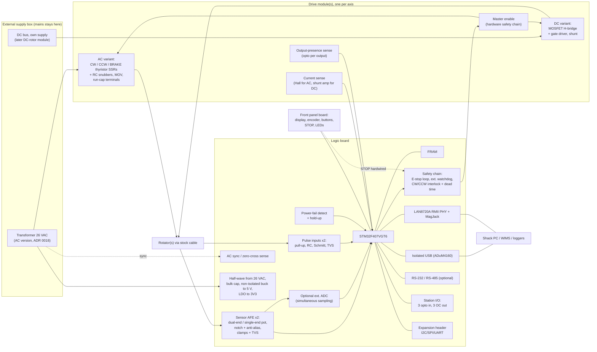

# Open Rotator Controller: v1 Hardware Requirements (processor-agnostic)

*Draft 1, Oct 10, 2026. WA1HCO. Follows `system-overview.md` and `feature-survey.md`.*

## 0. Locked decisions (from you)

1. **Mains and the transformer stay outside the controller.** The AC version has one 26 VAC feed and no separate logic supply (ADR 0018). Motor switching uses solid-state switches rated for the load. AC switching must either switch at zero current, or use snubbers to tame the inductive kick.
2. **Full replacement** of the stock controller.
3. **All sensor inputs:** dual-end pot, single-ended pot with excitation, pulse/reed counters.
4. **Two axes** at the sensor and MCU level. The motor drive is modular or a conditional assembly.
5. **USB and Ethernet are both required.** The MCU is an STM32F407VGT6 with a LAN8720A RMII PHY. The W5500-on-SPI option is dropped. See the evening addendum below and `mcu-ethernet-lcsc.md`.

Markers used below:
- **[V]** verified against a datasheet or manual (sources in section 13).
- **[U]** unverified, an estimate, or needs a bench measurement.

---

## 1. Block diagram

---

## 2. Board partitioning

| Board | Contents | Notes |
|---|---|---|
| **Logic board** (one) | STM32F407VGT6, 2 sensor front ends, pulse inputs, optional external ADC, FRAM, power-fail detect, safety chain, zero-cross sense, isolated USB, Ethernet (LAN8720A + MagJack), optional RS-232/RS-485, station I/O, drive-module connectors (x2), front-panel connector, expansion header, half-wave/buck/LDO from the 26 VAC | No mains and no motor current through the logic plane. Logic ground is the rotor return (ADR 0018). The drive-module connector stays the same if the MCU changes |
| **Drive module, AC variant** (one per AC axis) | Master-enable switch, CW/CCW/BRAKE switches, RC snubbers, MOV, run-capacitor terminals, Hall current sensor, output-presence opto sense, rotor-power terminal block | v1 build for HAM-IV/T2X |
| **Drive module, DC variant** (one per DC axis) | Reverse-polarity + fuse, bulk caps, H-bridge, gate driver, shunt amp, TVS, output-presence/voltage sense, terminal block | v2 (Yaesu DC, Prosistel, SPID, M2) |
| **Front panel board** | Display, encoder + push, CW/CCW/STOP + 2–4 buttons, status LEDs, I2C GPIO expander | Ribbon to the logic board; STOP also wired into the safety chain |
| **External supply** (separate box) | Mains entry, fuse, 26 VAC transformer for the AC version | Keeps mains out of the controller. No 13.8 V logic brick and no isolated DC-DC (ADR 0018). A later DC-rotor module has its own supply |

### Module vs. conditional SSR population

| Approach | Pros | Cons |
|---|---|---|
| **Separate drive modules** (AC board, DC board) behind one logic-board connector | AC and DC layouts are optimized separately (creepage, snubbers vs. gate drive); mixed AC-az + DC-el builds possible; easy to repair a failed power stage | One extra connector per axis; two PCB designs |
| **One power board, conditional assembly** of AC or DC parts | One PCB, cheaper at low volume | Both footprints compromise each other; unused parts zones; harder thermal design |

**Recommendation:** use **drive modules**, one module per axis, two variants. Both share a logic-side connector:
- Enables: CW, CCW, BRAKE/AUX, PWM_A, PWM_B, MASTER_EN.
- Returns: I_SENSE (analog), OUT_SENSE ×3, FAULT, MODULE_ID (resistor to ADC, or I2C EEPROM).
- Power: logic 3V3/5V and ground. Ground is the rotor return.

The firmware reads MODULE_ID and refuses to drive a mismatched profile.

---

## 3. Power architecture

ADR 0018. The AC version has one input. There is no separate DC logic supply, no isolated DC-DC, and no 12 V input. The 12–48 V row below is the later DC-rotor module's own motor supply, not a logic feed and not a connector on this AC box.

| Rail | Source | Use | Requirement |
|---|---|---|---|
| **26 VAC input** | External transformer, rear-panel Anderson Powerpoles, grey + black (V2 colors) | Motor, brake, and the logic rails derived below | HAM-IV: motor 24 VAC 2.25 A, brake 24 VAC 5 A, stock transformer 26 VAC 10 % duty [V]. Simultaneous motor + brake ≈ 7.3 A × 26 V ≈ **190 VA intermittent** [U]. Polarity does not matter. The colors key the plug so it is not a red/black 12 VDC pair. 15 A Powerpole contacts cover the intermittent current. Exact housings are the V2 pair; Mouser numbers TBD |
| **Logic 5 V and 3.3 V** | Half-wave rectifier from that 26 VAC, bulk cap, non-isolated buck (≥ 60 V in) to 5 V, LDO to 3.3 V | MCU, PHY, LEDs, optos, front panel | See the sizing below. Power-fail detect watches the bulk rail, with hold-up for a FRAM write (≥20 ms after the threshold [U, size on bench]) |
| **DC bus** | The later H-bridge module's own supply | DC drive module only | RT-21-class coverage 12–48 VDC @ 5 A [V]; SPID 12–24 V, Yaesu DXC 11–24 V, Prosistel 24 V, M2 27 V/3.2 A [V]. Not part of the AC controller. Prop-pitch 10 A is out of v1 scope |
| **Pot excitation** | Logic board, from the derived rails or a reference | Sensor front ends | See section 5. Not a second input |

The 26 VAC feed is the only power into the AC box. Unplugging the Powerpoles removes motor power and logic power together. There is no separate lockout that leaves the display and USB up. The zero-cross circuit still reports that the transformer is present.

**Rear-panel opening for the Powerpoles.** Two options. The bracket is TBD, so the drawable default is the gland:

- Pigtail through a gland. Default cutout Ø16.3, center 11.00 mm above the board (plate Y = 38.40, X = 17.50). Same opening class as the rotor gland. Gland size is [U].
- 2-position panel-mount Powerpole bracket. Cutout and center height TBD. Do not drill that hole until a bracket is chosen. Then set `PanelCutout` and `PanelZ` and regenerate (ADR 0017).

The old 22.00 × 12.50 terminal-block opening, and the idea that it carried 13.8 V plus 26 VAC, are withdrawn. The pre-layout PDF still shows that opening.

**Grounding.** In the CDE/Hy-Gain wiring, **terminal 1 is the common for the motor windings, the brake, and the pot wiper** [V, N0AX]. Motor and brake return current flows in the same wire as the wiper reference. The dual-end measurement has to use that node, because of the pot's ground and the transients on it. So logic ground is terminal 1, and the whole controller floats on the rotor return.

Consequences:
- **USB is isolated** by the ADuM4160. **Ethernet is isolated** by the MagJack magnetics. RS-232 is an optional non-isolated port (document it). Those are the isolation barriers. The buck is non-isolated: its ground is the rotor return.
- The transformer secondary floats in the supply box. It is referenced only at terminal 1.
- Switches sit on the **hot** side. Terminal 1 is the return.
- The rear-plate ground stud bonds the chassis to station ground. The rotor return connects to the chassis through an RF capacitor in parallel with a TVS. Values TBD. That is not a DC short, and it is not a hard bond of logic ground to the chassis.

### 3.1 Logic-rail sizing

26 × √2 = 36.8 V, about **37 V** peak. One diode drop puts the nominal crest on the bulk cap near **36 V**. The V4 notes treated that rail as roughly 33–48 V; 48 V is the light-load / high-line figure used here, and it was not re-measured [U].

**Linear-only, rejected.** Load estimate: F407 ~100 mA, LAN8720A ~50 mA, LEDs and optos 50–100 mA, so **200–250 mA** at 5 V. Dissipation from the bulk rail is (V_bulk − 5 V) × I. At 36 V and 200 mA that is 6.2 W. At 36 V and 250 mA it is 7.8 W. At 32 V and 220 mA it is 5.9 W. About **6–7 W** in the box, which the V4 SOT-89 LDO could not shed. Rejected.

**Buck, then LDO.** Non-isolated buck, input rating ≥ 60 V, 5 V out, then an LDO to 3.3 V. At 85 % and 250 mA the buck wastes about 0.2 W. The LDO at 150 mA (MCU + PHY) from 5 V to 3.3 V wastes about 0.3 W. Keep LEDs and optos on 5 V. Give the ADC its own filtered 3.3 V or a VREF so the buck's ripple is not the pot reference. LDO and reference part numbers are TBD.

**Bulk cap**, sized to ride through the sag when the ~5 A brake pulls in. It does not have to run the board for the whole brake-on interval. Assumptions [U]:

| Item | Value |
|---|---|
| Ride-through | 100 ms (about six cycles at 60 Hz) |
| Droop | 36 V down to 18 V (ΔV = 18 V), still enough for a 60 V buck to make 5 V |
| Efficiency during the droop | 80 % |
| Average voltage during the droop | 27 V |
| Discharge current | (5 × 0.250) / (0.80 × 27) = 58 mA. Use **80 mA** |

C = 0.080 × 0.100 / 18 = **444 µF**. Use **470 µF, 63 V**. Normal half-wave ripple is 0.080 / (60 × 470 µF) = 2.8 V. If a measurement shows a deeper or longer sag (200 ms down to 12 V), the same formula gives about 670 µF, so go to 1000 µF. If the crest exceeds 63 V, use an 80 V or 100 V cap.

The half-wave diode sees about two peaks (about 74 V) and the cap inrush. Use ≥ 100 V, 1 A. Not a 1N4148. Part TBD.

Half-wave DC bias in the transformer is this 60–80 mA, one polarity only. Against a 5 A brake that is about 1–2 %. Acceptable at this load. Do not half-wave the motor or the brake.

**Buck candidates** (LCSC pages read 2026-10-12; stock not checked):

| Part | Input | Current | LCSC |
|---|---|---|---|
| TI LM5164DDAR | 6–100 V | 1 A | C477928. Preferred: 100 V still fits if the crest is above 60 V |
| TI LMR36006BRNXR | 4.2–60 V operating, 66 V transient abs max | 0.6 A | C1850367. Meets the 60 V floor; a continuous crest above 60 V does not |
| MPS MP9486 | 100 V class, 1 A class, fixed-5 V option exists | | C-number TBD |

Not candidates: LMR51430 is 4.5–36 V (LCSC C5185863 exists, and the voltage does not). MP4560 was not confirmed at ≥ 60 V.

---

## 4. Motor switching

### 4.1 HAM-IV/T2X circuit facts (what the switch must handle)

| Item | Value | Status |
|---|---|---|
| Motor | 24 VAC, 2.25 A, capacitor-start/capacitor-run | [V] HAM-IV manual |
| Brake solenoid | 24 VAC, 5.0 A; coil ≈ 0.75 Ω + cable | [V] manual; [V] N0AX |
| Power transformer | 26 VAC, 10 % duty, thermal switch | [V] |
| Run capacitor | 120–140 µF non-polarized motor-start type, in the control box | [V] N0AX (value range) |
| Motor windings | Each half ≈ 2.5 Ω to common (1-8, 1-4); terminal 5 → right limit → 8; terminal 6 → left limit → 4 | [V] N0AX resistance table |
| Cable resistance limits | Terminals 1–2 ≤ 0.8 Ω; others ≤ 2.0 Ω | [V] manual |
| Cap placement | Across the winding ends (4–8) inside the control box | **[U] confirm on the HAM-IV schematic** |
| Voltage across the run cap while running | Exceeds line in a capacitor-run motor; estimated 1–2× line → up to ~75 Vpk at 26 VAC | **[U] measure** |
| Brake pull-in current | 5 A rating; inrush likely higher (0.75 Ω DC coil) | **[U] measure** |

**Reversing hazard.** CW feeds terminal 5 (→ winding end 8); CCW feeds terminal 6 (→ winding end 4); the run cap sits between 4 and 8.

- **While CW is on,** the off CCW switch sees the **run-cap voltage**. That can be larger than line, and it changes sharply at turn-on, so the off switch needs blocking margin and dv/dt immunity (or a snubber).
- **If CW and CCW are on together,** the charged 120–140 µF cap is **shorted through both switches and both limit switches**. Both windings are also driven in phase (stall current). Expect a destructive current pulse, limited only by switch, limit-switch, and wiring resistance.
- **Thyristor SSRs keep conducting until the next current zero** after the command is removed (CX series: turn-off ≤ ½ cycle [V]). So "CW off; CCW on" in consecutive firmware lines **is** the both-on case.
- **A shorted SSR (the common failure mode) on one side** makes the next command for the other direction the both-on case.

**Required protections (hardware, not just firmware):**

1. **Logic interlock per axis:** `CW_drive = CW_cmd · ¬CCW_cmd · EN` and vice versa (gates on the logic board, not firmware).
2. **Hardware dead time:** after either direction's command drops, block the other for **≥ 2 line cycles (≥ 40 ms)**. Use an RC + Schmitt or monostable. Firmware adds a **reversal dwell of seconds** (motor and antenna stopped, brake engaged) on top.
3. **Output-presence sense:** an opto across each switched output (CW, CCW, BRAKE). It detects a stuck-on (shorted) SSR, and the firmware then opens the **master enable**.
4. **Master enable** in the hot feed, upstream of all three switches, driven by the hardware safety chain (E-stop loop · external watchdog · MCU enable). Use a mechanical relay switched **only at no load** (the sequence guarantees all direction switches are off first), or a 10 A-class SSR. A mechanical contact gives a true air gap when a semiconductor has failed short.
5. **Limit-switch awareness:** an open limit at end of travel looks like "no current" on that output. The firmware must not call it a fault when position is at the end.

### 4.2 Zero-voltage turn-on vs. random turn-on vs. turn-off behavior

| Switch technology | Turn-on | Turn-off | Inductive-kick behavior | Notes |
|---|---|---|---|---|
| **Thyristor (SCR pair / triac) SSR, zero-cross** | Only near a voltage zero (CPC1966: up to 20 V first half-cycle window [V]) | **Natural, at current zero** | **No switch-generated kick**: current is zero when it stops conducting | For an inductive load, voltage zero = current peak in steady state. Turning on at voltage zero gives the **maximum DC-offset/flux transient** in iron-core loads (solenoid, motor). Some zero-cross SSRs also need a minimum power factor to latch (CPC1966: PF ≥ 0.25 [V]; CX: min PF 0.5 [V]). Crydom itself recommends random-fire for inductive loads [V] |
| **Thyristor SSR, random (instant) turn-on** | Immediate | Natural at current zero | No switch-generated kick | Better for inductive loads. With a zero-cross sense input, firmware can fire **near the voltage peak** to minimize inrush in the brake solenoid [U benefit; validate on bench] |
| **MOSFET photovoltaic / isolated-driver AC switch** (back-to-back MOSFETs) | Immediate (Si875x ≈ 94 µs at 10 mA input [V]) | **Immediate at any current** | **Generates L·di/dt kick** unless firmware turns it off near current zero, or a TVS/snubber clamps it | Very low drop (tens of mΩ), works for AC **and** DC. Needs blocking ≥ cap voltage + kick, plus a TVS across each switch |

**Recommendation for AC rotators:** use **random-turn-on thyristor switches** for CW, CCW, and BRAKE. Their **natural zero-current turn-off** removes the inductive kick at the source, which meets your "switch at zero current" requirement. Add an **RC snubber across each switch** for dv/dt immunity (the off-direction switch sees the run-cap transient), and an **MOV across the 26 VAC input**.

Add a **zero-cross/sync input** (opto on the 26 VAC feed) for:
- firing near the voltage peak (brake/motor inrush control);
- confirming motor-supply presence;
- 50/60 Hz detection, which sets the notch-filter frequency.

### 4.3 AC switch candidates (datasheet ratings)

| Part | Type | Load voltage | Load current | Surge | Turn-on | Fit for HAM-IV |
|---|---|---|---|---|---|---|
| **IXYS CPC1966Y** (on your V4 board) | Dual SCR, SIP-4 | 20–240 Vrms (continuous rating specified at 120–240 V) | **3 A rms** | 30 A (<16 ms) | Zero-cross only (first half-cycle window ≤20 V) | Motor (2.25 A): marginal margin, and the low-voltage zero-cross window is large relative to 37 Vpk. **Brake (5 A): does NOT meet** [V] |
| **Sensata/Crydom CX240D5** / **CX240D5R** | SCR, SIP | 12–280 Vrms | 5 A max (min 0.06 A) | 250 Apk (16.6 ms) | D5 = zero-cross; **D5R = random** | Motor: good (2.2× current margin, low-voltage OK, random version available). Brake: **at the 5 A limit, no margin**. Derating curve not checked [V ratings / U derating] |
| **Omron G3NA-205B** / **G3NA-210B** | Phototriac, panel mount, screw terminals | 19–264 VAC | 205B: 5 A with heatsink (3 A without); **210B: 10 A with heatsink** (4 A without) | 60 A / 150 A (1 cycle) | Zero-cross only; Omron notes longer delay below 75 VAC | 210B for the brake (chassis-mounted). Zero-cross-only is a drawback for inductive loads [V] |
| **Discrete: snubberless triac (BTA16-600BW class) + random-phase optotriac driver (MOC3023 class)** | Triac + opto | Up to 600 V | 16 A class | High | Random | Brake (and motor), on the drive module with a heatsink tab to chassis. **[U] verify chosen parts' IGT/dv/dt ratings** |
| **Discrete: Si8751/Si8752 + 2× N-MOSFET (≥150 V)** | Isolated FET driver (no secondary supply), back-to-back MOSFETs | Set by the MOSFETs | Set by the MOSFETs | Set by the MOSFETs | Immediate; Miller clamp for dv/dt | Lowest loss, AC **and** DC. Needs a TVS per switch and a kick strategy. Si875x is for ≤7.5 kHz switching, so no high-frequency PWM [V] |
| Panasonic AQZ202 (PhotoMOS AC/DC) | MOSFET SSR | 60 V peak | 3.0 A | — | Immediate | **Not suitable:** 60 Vpk is below the estimated run-cap voltage plus kick [V rating / U cap voltage] |
| IXYS CPC1709 | MOSFET SSR, **DC only** | 60 V | 9 A no heatsink, 22.8 A with 5 °C/W | — | ms-class | DC only, 60 V → not for AC; a DC option is in section 4.5 [V] |

**AC recommendation (v1 AC drive module):**

| Function | Choice | Reason |
|---|---|---|
| CW, CCW (2.25 A) | **CX240D5R** (random-turn-on SIP) **or** discrete triac + random optotriac | 2× current margin; natural zero-current turn-off; 250 Apk surge |
| BRAKE (5 A, inrush) | **Discrete snubberless triac (16 A class) + random optotriac**, tab to chassis heatsink. Alternative: G3NA-210B chassis-mounted (zero-cross only) | Needs real margin over 5 A and the pull-in surge |
| Master enable | Mechanical relay rated ≥10 A at 30 VAC, switched only at no load (or a 10 A-class SSR) | True disconnect on a failed-short SSR |
| Snubbers | RC across each switch: start at **47–100 Ω + 0.047–0.1 µF X2-rated** cap [U: tune on bench for dv/dt and leakage]. At 26 VAC, RC loss and off-state leakage are small | dv/dt immunity for the off-direction switch |
| MOV | Across the 26 VAC input: varistor with **Vrms rating ≥ 1.25 × max line** (26 VAC + mains tolerance → ~35 Vrms class) [U: pick part, check clamp vs. the 600 V thyristor rating (ample)] | Line transients |
| TVS at the rotor terminals | Bidirectional, standoff above the max run-cap peak (your V4 SMAJ90CA has 90 V standoff [V part on board / U fit]) | Cable-induced transients, lightning secondary |

**Do not reuse the CPC1966 for the brake.** It is acceptable for the motor only after a bench check of turn-on at 26 VAC under load.

### 4.4 Thermal (AC module)

- Chosen triac: BTA16-600SW (Vto 0.85 V, Rd 25 mΩ [V]). Nameplate worst case: **motor 2.25 A ≈ 1.85 W**, **brake 5 A ≈ 4.5 W**. One direction triac and the brake conduct together: **≈ 6.35 W**. At the measured currents (brake ~2 A, motor ~0.7 A) it is ≈ 2.15 W.
- The transformer's 10 % duty and a **firmware single-run cap of ≤ 120 s** keep the **average** low. Steady state only matters for a stuck-on fault, which the master relay and watchdog cover.
- **Mounting (chosen; see the Packaging addendum and `triac-thermal-packaging.md`):** insulated-tab triacs soldered to the PCB and bolted to an aluminum bar that is screwed to the PCB. The bar is clamped to the enclosure's flat top wall through a 1.0 mm gap pad. **No separate insulator**: the tabs are internally isolated (2500 Vrms).
- Worst-case brake Tj ≈ 84 °C at 40 °C ambient (Tj max 125 °C).
- The MOSFET alternative (2 × ~20 mΩ) would drop dissipation to about 1 W at 5 A. This is its main advantage.

### 4.5 DC motors (v2 DC drive module)

| Option | Pros | Cons | Verdict |
|---|---|---|---|
| **MOSFET H-bridge** with half-bridge gate drivers, 60–100 V MOSFETs (48 V bus + margin) | Full PWM (16–25 kHz), soft start/stop, dynamic braking, low loss, current sensing in the bridge | More design (dead time, bootstrap, layout); PWM edges on a long cable radiate | **Recommended** |
| DC SSRs (e.g. CMX60D10 0–60 VDC 10 A [V]; CPC1709 60 V [V]) ×4 as a bridge | Simple, isolated | Slow (ms) switching → no real PWM; shoot-through risk if timing is wrong; 60 V parts leave little margin at 48 V | Not recommended |
| One DC SSR (on/off) + DPDT reversing relay switched only at zero current | Very simple, robust; relay never breaks current | No speed control/ramps (lose the main DC benefit) | Fallback / budget variant |
| Si875x bidirectional switches as an H-bridge | Same switch type for AC and DC | ≤7.5 kHz, slow edges → only low-frequency PWM | Interesting for a "universal" module; not v1 |

**DC module requirements:**
- 12–48 V bus, 5 A continuous (RT-21 class [V]).
- PWM ~20 kHz with **slew-rate-limited edges** (gate resistors) and an optional common-mode choke / small LC output filter for long rotor cables [U: evaluate radiated noise on HF].
- Fuse, reverse-polarity protection, and bulk electrolytic plus film capacitors on the bus.
- TVS across the bus and the motor terminals.
- Shunt and current-sense amplifier with PWM-rejection: a **INA240-class** part [U: verify CM range and gain choice].
- Gate driver: classic **IR2104/IR2184-class half-bridge drivers** or a modern 100 V-class H-bridge gate driver [U: final part TBD]. **Avoid 45 V-max integrated drivers** for a 48 V bus.

### 4.6 Current sensing summary

| Module | Method | Why |
|---|---|---|
| AC | **Isolated Hall sensor** in the hot feed after the master enable (ACS724/ACS712 class, ±10–20 A range [U: verify part ratings]); optional second sensor on the brake | Doesn't disturb terminal 1 (the pot reference); detects stall, open motor, stuck switch, and a dried-out cap (current signature) |
| DC | Low-side or in-bridge shunt + PWM-rejecting amplifier | Over-current, jam, stall, health trending |

---

## 5. Sensor front ends (×2 axes)

### 5.1 Pot inputs

Each axis has **two analog inputs (A, B) plus a mode select.** Use analog switches or jumper-selectable resistor networks [U: choose analog switch ratings for ±TVS-clamped inputs].

| Mode | Wiring | Excitation | Signal |
|---|---|---|---|
| **Dual-end (CDE/Hy-Gain)** | Pot ends to A and B; wiper = rotor common (terminal 1) = AFE ground | Each end biased through **330 Ω from 3.3 V** (your existing values RBIAS = 330 Ω, RPOT = 500 Ω, Vs = 3.3 V [V in your code]) | Solve for Rtop from Vtop/Vbot (WA8USA equation in `ReadAzimuthCDE.cpp`) |
| **Single-ended (Yaesu, Prosistel, generic)** | Pot ends to EXC+ and AFE ground, wiper to A | Buffered **5.0 V** (or 4.096 V) reference, current-limited (Prosistel: 10 kΩ pot, 5 V [V]; RT-21 covers 150 Ω–10 kΩ [V]) | Ratiometric: also measure EXC on a channel |
| **External voltage** | 0–5 V position voltage | None | Divider/buffer to the ADC range |

**Chain per input:**
terminal → **bidirectional TVS** (SMAJ-class) → series resistor → **60 Hz twin-T notch** (as in your 2022 board; make it populate-selectable for 50 Hz builds) → **clamp diodes** to the ADC rail (BAS40-04 as on V2; or 3.6 V zener as V3) → RC anti-alias (corner ~50–100 Hz) → ADC.

Order matters: you moved the overvoltage diodes after the notch so 60 Hz doesn't clip and shift DC [V, your 2022 commit]. Keep that order.

**ADC requirements:**

| Item | Requirement |
|---|---|
| Channels for position | 2 per axis (A, B) + 1 excitation monitor (shared) = **5** |
| Resolution | **≥12-bit** native, with ×16 oversampling. 0.1° over 360° needs ≥3600 distinguishable counts after filtering |
| Sample rate | ≥500 Hz per channel (your 2 ms ISR + 31-tap FIR) |
| Simultaneity | A and B sampled **simultaneously** (or back-to-back within µs), so common ripple cancels in the dual-end solve |
| Option | Footprint for an external **4-channel simultaneous-sampling ΔΣ ADC** (ADS131M04 class [U: verify specs]) on SPI, for both pot channels of both axes. MCU ADC still handles current/supply |

### 5.2 Pulse/reed inputs (×2)

- **Pull-up supply:** selectable 5 V / 12 V via a current limiter (PTC + resistor). M2 reed circuit ≈ 11.3 VDC while moving [V]; SPID reed/magnetic [V type].
- **Conditioning:** TVS → series R → RC low-pass → Schmitt buffer (or opto) → MCU timer capture/counter input.
- **Rates:**
  - RT-21 supports up to 64 pulses/° [V]; at ~10°/s that is ≈ 640 Hz [U].
  - SPID 1 pulse/° at 360°/45–120 s is a few Hz [V specs].
  - M2: 3960 pulses/360° [V]; speed [U].
  - Set the RC corner ~2–5 kHz, and debounce in firmware (minimum pulse width).
- **Direction:** reed sensors give no direction, so count direction comes from the drive state. **Coast after motor-off still produces pulses**, so the counter must stay powered through coast (see 5.3).
- **Quadrature option:** a second input per axis on the expansion header (encoder A/B).

### 5.3 FRAM + power-fail detect

- **FRAM** (I2C or SPI, ≥32 KB) holds the settings record, calibration tables, and **pulse-count checkpoints** (written on every stop, plus on power fail). Effectively unlimited endurance vs. EEPROM.
- **Power-fail detect:** a comparator on the **bulk rail** (ahead of the buck), set above the buck's dropout, feeding an MCU interrupt. Size the hold-up so the MCU can finish the FRAM write and drop the master enable (≪10 ms needed; target ≥20 ms [U]). The 470 µF brake-sag cap is not automatically that hold-up; check the droop at the moment the transformer actually disappears.
- **Coast problem:** if the 26 VAC feed dies while a pulse-sensor rotator coasts, coast pulses are lost. The AC version has no independent logic supply (ADR 0018). Mitigations:
  - the bulk cap covers a short sag, not an unplugged transformer;
  - the firmware flags "count uncertain" after an unclean shutdown and asks for re-cal;
  - optional larger hold-up or a supercap [U: size from measured coast time].

---

## 6. Communications

| Port | v1 status | Implementation options | Recommendation |
|---|---|---|---|
| **USB serial (control)** | **Required** | MCU native USB full-speed (PA11/PA12) through an ADuM4160 isolator to USB-C. The same socket is the CDC console and the ROM DFU port | Native USB, not an FT230X bridge. The STM32F407 system-memory bootloader speaks USB DFU, not a UART. Wiring is the programming addendum below |
| **Ethernet** | **Required** | STM32F407 MAC + LAN8720A-CP-TR RMII PHY + 25 MHz crystal (PHY supplies 50 MHz REF_CLK) + through-hole MagJack. LAN8742A-CZ-TR is the same-footprint fallback | Magnetics give galvanic isolation. **PoE is not used.** The earlier W5500-on-SPI option is dropped (evening addendum) |
| **RS-232** | Optional (populate) | MAX3232-class + DB-9 | Legacy loggers/hardware; not isolated (document it) |
| **RS-485** | Optional (populate) | Half-duplex transceiver + terminal block, shares a UART with RS-232 by population | For future tower units / daisy-chain ("new idea") |
| **Debug** | Required | Tag-Connect TC2050-IDC-NL pads: SWDIO, SWCLK, SWO, NRST, VTREF, GND. No header is placed | Chosen over a 10-pin 1.27 mm Cortex header because the footprint needs no part. See the programming addendum |

---

## 7. Station I/O

| Signal | Qty | Spec | Use |
|---|---|---|---|
| **E-stop loop input** | 1 | Normally-closed loop, opto-isolated, 5–24 V; **also hard-wired into the safety chain** | Front-panel STOP + external stop |
| Opto inputs | 2 | 5–24 V, ~2–5 mA, reverse protected (like your sequencer's KEY input) | Rotate-inhibit (from SO4R_Interlock / sequencer), spare (wind alarm) |
| Open-collector outputs | 3 | ≥60 V, ≥300 mA (same class as your SO4R PTT output), TVS | "Rotating", fault/overlap, aux |
| Connector | 1 | Pluggable terminal block | — |

**Safety chain (hardware):**

`MASTER_EN = E-stop_loop_closed · external_watchdog_OK · MCU_enable · motor_supply_present`

It drives the master-enable switch on each drive module. Direction interlock and dead time live on the logic board, downstream of the MCU pins.

---

## 8. Front-panel interface

- **One ribbon (2×10, 2.54 mm):** 3V3, 5V, GND×3, I2C (SDA/SCL), SPI (SCK/MOSI/MISO), display CS, display DC/RS, encoder A/B/SW, expander INT, backlight PWM, STOP (to the safety chain and an MCU input), LED data (optional).
- **On the panel board:** I2C GPIO expander for buttons/LEDs, so the MCU spends few pins.
- **Display options** behind the same connector: MAX7221 7-segment (SPI), 20×4 LCD (I2C backpack), small TFT (SPI).

---

## 9. Rotor-cable connectors (per axis)

| Option | Notes |
|---|---|
| **Split blocks per axis** (recommended): a **power block** (COM, CW, CCW, BRAKE + 2 run-cap terminals) on the drive module, and a **sensor block** (POT_A, WIPER/COM_SENSE, POT_B, EXC, PULSE+, PULSE−, SHIELD) on the logic board | Pluggable 5.08 mm blocks, power block rated ≥10 A per pole. Labels show HAM-IV terminal numbers 1–8 next to function names, so existing wiring moves terminal-for-terminal |
| **CDE common link** | HAM-IV has **one common wire (terminal 1)** shared by motor, brake, and wiper [V]. Land it on the power block COM and run a **sense link** to the sensor block WIPER/COM_SENSE (board jumper or short link wire). This keeps motor current out of the AFE ground trace on the board |
| **Stock connector adapters** | HAM-IV: barrier strip (older) / 8-pin Cinch connector on newer units [V, from manual listing]. Provide an adapter pigtail. Yaesu circular connectors and pinouts: **[U] check per model before v2.** Prosistel: 5-wire (2 motor + 3 pot) [V]. M2: motor terminals 1–2, reed 5–6 [V] |
| **Miswiring protection** | TVS + series R on all sensor pins so a motor wire on a sensor pin is survivable for a short time [U: test at 37 Vpk and 48 VDC] |

---

## 10. Protection and EMC (high-RF station)

- **At every cable entry:** ferrite (or an RF choke on low-current lines) + 1–10 nF to the **chassis** right at the connector, then the TVS, then series R. Pot and pulse lines: RF bypass that doesn't load the notch (check on the bench).
- **Metal enclosure,** connectors bonded to the chassis, logic board with a solid ground plane.
- **Lightning:** primary protection (arrestors/GDTs, single-point ground) belongs at the tower/entry panel and is **external**. The board provides secondary TVS clamps.
- **Isolation:** USB isolated; Ethernet via magnetics; RS-232 non-isolated (option).
- **Switching regulators:** choose fixed-frequency parts with good input/output filtering; keep harmonics away from sensitive receive frequencies, or use spread spectrum if acceptable [U: measure on HF/6 m receivers].
- **PWM (DC module):** 16–25 kHz with controlled edges; optional common-mode choke at the motor terminals.
- **Thyristor switching** at current zero (natural turn-off) produces little broadband noise; random turn-on at a voltage peak can make a small step, which the RC snubber softens.
- **Firmware RF checks:** detect RF-induced pot jitter (variance) and report it; optional rotate-inhibit during TX (section 7).

---

## 11. MCU peripheral and pin budget (processor-agnostic)

| Function | Peripheral | Pins (direct) | Notes |
|---|---|---|---|
| Pot A/B ×2 axes + excitation monitor | ADC | 5 | Or external SPI ADC (CS + DRDY = 2 pins) |
| Motor current ×2 | ADC | 2 | From drive modules |
| Bulk-rail + DC-bus monitors | ADC | 2 | Dividers. Bulk rail is the AC version; the DC bus is the later module |
| Module ID ×2 | ADC | 2 | Resistor ID (or I2C EEPROM on modules: 0 pins) |
| Optional joystick/preset pot | ADC | 2 | Expansion |
| **ADC subtotal** | **11–13 channels**, ≥12-bit, DMA | | ≈13 ch × 500 Hz × 16 oversample ≈ 100 kSPS aggregate |
| Pulse counters ×2 | Timer capture/counter | 2 | + 2 for quadrature (header) |
| AC zero-cross sync | Timer capture | 1 | Also detects 50/60 Hz |
| Drive per axis: CW, CCW, BRAKE/AUX, PWM_A, PWM_B | GPIO + PWM timer | 5 × 2 = **10** | PWM_A/PWM_B on timer channels (4 PWM total) |
| Drive FAULT per axis | GPIO/IRQ | 2 | |
| Output-presence sense (3 per axis) | GPIO | 6 | Can move to the I2C expander |
| MCU_enable (safety chain), watchdog kick | GPIO | 2 | External watchdog |
| Power-fail detect | GPIO/IRQ (or comparator) | 1 | Highest-priority IRQ |
| AFE mode select (×2), pulse pull-up select (×2) | GPIO | 4 | Can move to the I2C expander |
| USB FS (CDC and ROM DFU) | USB OTG FS, through the ADuM4160 | 2 (PA11/PA12) plus VBUS sense if used | Full speed. PIN tied to VDD2. See the programming addendum |
| RS-232 / RS-485 | UART (+DE) | 2–3 | Shared by population |
| Ethernet RMII (LAN8720A) | RMII + MDIO/MDC + nRST | about 11 | REF_CLK from the PHY. Not a W5500 |
| FRAM | I2C (shared) or SPI CS | 0–1 | |
| Front panel | I2C (shared), SPI (shared) + CS, DC, enc A/B/SW, INT, backlight PWM, STOP | ~8 | |
| Station I/O | GPIO | 6 | 3 in, 3 out (or via expander) |
| Status LEDs | GPIO | 2 | |
| Expansion header | I2C, SPI, UART, 2 GPIO | 2 GPIO + shared buses + 2 UART | |
| Debug | SWDIO, SWCLK, SWO on the TC2050-IDC-NL pads; NRST shared with the RESET button | 3 plus NRST | No populated header |
| **Total direct GPIO** | | **≈ 70 pins** all direct; **≈ 50** with an I2C expander for slow signals (sense, mode selects, station I/O) | The chosen MCU is the 100-pin STM32F407VGT6. A 64-pin F405 has no Ethernet MAC, and ST does not make a 64-pin F407 |

**Peripheral counts:** UART ×2 (RS-232/485 and expansion); USB OTG FS for CDC and ROM DFU (not a UART bridge); SPI ×1 (display, external ADC); Ethernet is the MCU MAC, not a SPI controller; I2C ×1–2; timers for 4 PWM + 3 capture + system tick; ADC 11–13 channels with DMA; hardware watchdog; FPU helpful (dual-end solve, FIR).

**Memory:** the chosen part, STM32F407VGT6, has 1 MB flash and 192 KB RAM. The stack is the MCU MAC plus a host network stack (lwIP or equivalent), not a W5500 offload. 192 KB is the RAM the design has to live in [U: measure the stack].

---

## 12. Open questions (ranked)

1. **Measure on a real HAM-IV/T2X with your scope:**
   - run-cap voltage (sets switch blocking and TVS standoff);
   - brake pull-in current and duration;
   - motor stall current;
   - confirm the cap is across terminals 4–8 in the stock box.
2. **Switch technology choice for AC:**
   - thyristor (CX240D5R / discrete triac), recommended for zero-current turn-off;
   - vs. MOSFET + Si875x (low heat, AC/DC universal, but needs kick handling).
   - A bench comparison of both on one HAM-IV would settle it.
3. **Master-enable element:** mechanical relay (true air gap) or SSR.
4. ~~**USB approach**~~ **Resolved (Oct 12, 2026):** native full-speed USB through the ADuM4160, so ROM DFU and CDC share USB-C. An FT230X bridge cannot enter the STM32 system-memory DFU bootloader. See the programming addendum.
5. ~~**Ground strategy**~~ **Resolved for the AC version (ADR 0018):** logic ground is the rotor return. Chassis bond is the ground stud to station ground. Rotor return meets the chassis only through an RF cap in parallel with a TVS. Those two part values are still TBD. Confirm RF and hum on the bench.
6. **Supply box:**
   - Reuse a stock HAM-IV transformer (10 % duty) or a new continuous-rated one?
   - The AC box does not take a logic DC feed. The later DC-rotor module's supply is still open.
7. **External simultaneous-sampling ADC** in v1, or footprint only?
8. **50 Hz support** in v1 (notch population variant)?
9. **Front-panel display** for v1 (MAX7221 vs. LCD vs. TFT); this decides the panel board and the enclosure cutout.
10. **Yaesu, SPID, and M2 connector pinouts and pot values** for the v2 DC module (not yet verified).
11. ~~Enclosure and heatsinking~~ **Resolved (Oct 11, 2026):** Hammond 1455N1601. Triacs go on a PCB-mounted bar clamped to the top wall through a 1.0 mm gap pad (Packaging addendum).

The next seven items come from the rotator catalog's hardware implications (`rotator-catalog.md`, "Hardware implications for the V4/F407 board"). They are not decided. Numbers below are the catalog's figures, not new measurements.

12. **Three pot modes, selected per axis.** CDE dual-end grounded wiper (500 Ω, wiper on the motor/brake common, with 60 Hz ripple). Single-ended, 150 Ω–10 kΩ. Rheostat (G-400RC, G-450XL, G-450ADC), which needs a known current source or a reference resistor. A 75 Ω pot (Alliance HD-73) needs current-limited excitation, about 20–30 mA at most, and must not sit straight across 5 V (67 mA). Leave a series-resistor footprint; the RT-21 uses 75–100 Ω.
13. **Pot excitation above 3.3 V, and a way to use a narrow span.** The HDR-300 uses only a third of its 3-turn pot (0.83–2.5 V of a 5 V excitation). Prosistel D spans about 0.78 V around 5.4 V. Provide a programmable offset/gain stage, or an external 16–24-bit ADC, and allow pot REF above 3.3 V (5 V, and possibly 8–13 V). Old Prosistel pots are specified at ±12 V. A unipolar REF still works on that passive pot, so a −12 V rail is not required.
14. **Two pulse channels per axis, with a selectable pull-up.** SPID HR has two Hall sensors, and Prosistel PRO has an encoder. Pull-up selectable between 5 V and 12 V, about 5 mA wetting (M2 runs about 11.3 V / 5 mA). RC filter, hysteresis, and ESD/RF protection, because SPID reports RF-induced false pulses. Rates stay under 1 kHz (about 72 Hz for M2).
15. **Run-cap placement has to be configurable.** The CDE value is chosen (ADR 0016): 100 µF plus 33 µF, 133 µF, across terminals 4–8. Yaesu and the HD-73 put the cap across the two drive ends. G-5500 and HDR-300 keep the cap in the rotor, so the board caps stay off. A jumper or relay, with the cap terminals separate from the drive terminals. Other catalog sizes run from 100 to 156 µF, at 50–60 VAC at least, 100 VAC for margin.
16. **Brake output defaults to engaged on a fault.** The CDE family needs it (24–30 VAC, 3.5–5 A steady, 0.75 Ω coil on the DCU-3 measurement, plus inrush). The HDR-300 needs one too; its voltage is not in the catalog. Its own triac or relay, and the unpowered or faulted state is brake engaged.
17. **DC module, 12–48 V.** That span covers SPID at 12–24 V, Yaesu at 11–24 V, Prosistel up to 42 V, and M2 at 28–42 V (about 45 V open circuit). 5 A covers most of the catalog. BIG-RAS/HR needs up to 12 A, and the SPID MD's 20 A outputs are beyond a 5 A module. Record that limit, or plan a 10–15 A option.
18. **48 VAC Prosistel is unsupported.** Older PST-51 / PST-61 / PST-71 boxes are 48 VAC. Peak line voltage plus the cap winding can exceed the SMAJ90CA 90 V standoff. Do not drive them with this board's AC stage.

---

## 13. Sources

- HAM-IV manual (motor 24 VAC 2.25 A cap-start/cap-run; brake 24 VAC 5 A; 26 VAC 10 % duty transformer; cable resistance limits): http://www.radiomanual.info/schemi/ACC_rotator/Hy-gain_HAM-IV_HAM-IVx_user.pdf
- N0AX, "How to Check Rotators from the Ground" (terminal color code 1–8, terminal 1 common, resistance table, 120–140 µF run cap): https://www.onallbands.com/how-to-check-rotators-from-the-ground/
- IXYS CPC1966 datasheet (3 Arms, 20–240 Vrms, 600 Vp, 30 A surge, zero-cross window ≤20 V, PF ≥ 0.25, holding current 44–50 mA): https://xonstorage.z8.web.core.windows.net/pdf/ixys_cpc1966y_apr22_xonlink.pdf
- Sensata/Crydom CX series (CX240D5/D5R: 12–280 Vrms, 5 A, 250 Apk, min PF 0.5, random "R" option for inductive loads): https://xonstorage.z8.web.core.windows.net/pdf/Crydom/535141XON.pdf
- Omron G3NA (205B/210B: 19–264 VAC, 5 A/10 A with heatsink, 3 A/4 A without, zero-cross): https://www.ia.omron.com/products/family/992/specification.html ; https://edata.omron.co.nz/eData/Relays/J146-E1-01.pdf
- Crydom CMX DC SSR (CMX60D10 0–60 VDC 10 A): https://www.todaycomponents.com/pub/media/datasheet/70131392.pdf
- Panasonic AQZ102/AQZ202 PhotoMOS (60 V; 4 A DC / 3 A AC-DC): https://industry.panasonic.com/global/en/products/control/relay/photomos/number/aqz102 ; https://xonstorage.z8.web.core.windows.net/pdf/Panasonic/3839671XON.pdf
- IXYS CPC1709 (60 V DC-only, 9 A no heatsink, 22.8 A @ 5 °C/W): https://datasheet.octopart.com/CPC1709J-IXYS-datasheet-180481057.pdf
- Skyworks/Silicon Labs Si8751/52 isolated FET driver (no secondary supply, AC via back-to-back FETs, Miller clamp, ≤7.5 kHz): https://www.skyworksinc.com/-/media/SkyWorks/SL/documents/public/data-sheets/Si8751-2.pdf ; https://www.skyworksinc.com/-/media/Skyworks/SL/documents/public/application-notes/an1052-selecting-fet-si875x-driver.pdf
- Green Heron RT-21 specs (12–48 VDC / 18–36 VAC @ 5 A, pot 150 Ω–10 kΩ, up to 64 pulses/°): https://www.greenheronengineering.com/product/rotator-controller-rt-21/
- M2 RC2800PX manual (27 VDC 3.2 A, reed ~11.3 VDC, 3960 divisor): https://www.m2inc.com/content/PDF%20MANUALS/RC2800%20SERIES/RC2800PXB-AZMAN04-W.pdf
- Prosistel PST-61/71 manual (24 VDC, 10 kΩ pot, 5 V excitation): https://www.arraysolutions.com/pdfs/Prosistel%20PST-61%20-%20PST-71%20and%20PST-110%20User%20Manual.pdf
- SPID RAS / Rot2Prog: http://spid.net.pl/en/ras-2/ ; https://www.wimo.com/media/manuals/SPID/25082_Satelliten-Rotor-Satellite-Rotator_Manual.pdf
- Your repos: Rotator_Controller `src/ReadAzimuthCDE.cpp` (RBIAS 330 Ω, RPOT 500 Ω, 3.3 V, 2 ms ISR, 31-tap FIR); Rotator_Controller_Board (60 Hz notch, OVP after notch); Rotator-Controller-V2 V4 branch as imported (drawing still shows STM32F405RGT6, CPC1966 ×3, ADuM4160, SMAJ90CA; the chosen MCU is the STM32F407VGT6, evening addendum); SO4R_Interlock README (FT230X custom strings, 60 V/300 mA OC outputs).

## Addendum (Oct 11, 2026): Rotor cable connector standard

Source: Steve Schultz WB8WGY, "Rotor Cable Connections" (Sep 27, 2013) and "Summary of CPC parts that Dave has on hand" (Mar 23, 2014); Dave Cipolle W1SZ, "Greylock 6m rotor question" (Feb 23, 2026); Ray Benny N6VR, TowerTalk (Feb 13, 2013).

The contest group's standard is TE (ex-AMP) CPC Series 1, shell size 13, 9 contacts, wired 1:1 on HAM-IV terminals 1-8, pin 9 unused. The "hot" (controller) end is always female (socket contacts) so no live pins are exposed.

| Use | TE part | Mouser | Notes |
|---|---|---|---|
| Rotor chassis receptacle | 206705-1 | 571-2067051 | Square flange, 4 holes, pin contacts; replaces HAM-IV terminal strip via adapter plate |
| In-line receptacle | 206705-2 | 571-2067052 | No flange |
| Cable plug (controller pigtail) | 206708-1 | 571-2067081 | Spin collar, socket contacts |
| Cable clamp, shell 13 | 206966-7 / 207008-5 (large) | 571-206966-7 | |
| Pin contacts 22-18 AWG | 66591-4 | | Use dash 4 (lead-free); dash 2 non-stock |
| Socket contacts 22-18 AWG | 66592-4 | | |
| Larger 14-18 AWG contacts (pins 1, 2) | (TE number not given) | 571-666012 socket / 571-666022 pin | Per N6VR; verify on Mouser |
| Sealing cap | 211870-1 | 571-211870-1 | |
| Trailer wall receptacle (reverse sex, sockets) | 211769-1 | 571-2117691 | Shell 17; shell 13 9-pin has no reverse-sex version |
| Trailer cable plug (reverse sex, pins) | 211768-1 | 571-211768-1 | Shell 17 |
| Trailer clamp, shell 17 | 206070-8 / 206322-9 (large) | | |
| Trailer cap | 208652-1 | 571-2086521 | |

Design implication: no panel-mount female exists in shell 13, so the controller uses a short 8-conductor pigtail ending in a 206708-1 plug (or a shell-17 211768-1 plug to mate the trailer wall), terminated inside on the 8-position pluggable terminal block. Bond the cable shield to a chassis lug at the entry. Dave's trailer wall adds an 8-pin feedthrough-capacitor box for RFI; consider the same filtering at the controller entry (see the RF bypass guidance: small Y2 caps to chassis, not across contacts).

## Addendum (Oct 11, 2026): Packaging

- **Enclosure:** Hammond 1455-series extruded aluminum box, e.g. 1455N1601: 160 × 103 × 53 mm, 6063 Al, 1.5 mm minimum wall, designed for a 100 mm wide PCB in internal slots (comb of 2.0 mm slots on a 3.5 mm pitch). Internal height 49.62 mm. Removable belly plate. [V Hammond drawing]
  - **The board slides into the side-wall slots.** The outline drawing uses Hammond's maximums: 159 × 99 mm, slot 6. Copper keep-out is 2.5 mm on the long edges, and component bodies stay 3.5 mm off those edges. See the Oct 12 addendum.
- **Front end plate:** CCW, STOP, and CW, plus six Dialight 551 right-angle LED holes. No light pipes.
- **Rear end plate:** all cables. Power inlet, M16 rotor gland, USB-C, RJ45, ground stud.
  - The rear plate and the PCB connectors form one subassembly.
  - No connectors on other faces and no internal wiring.
- **Triacs (CW, CCW, Brake), CHOSEN mounting:**
  - Three insulated-tab **BTA16-600SW** are **soldered to the PCB** and greased and bolted (M3 × 8 + Belleville) to a **6061 bar, 10 × 50 × H mm**.
  - The **bar is screwed to the PCB from below (2 × M3)**, so board, bar and triacs are one rigid unit and vibration can't stress the triac leads or solder joints.
  - The bar sits near the rear (x = 24..34 mm from the rear plate's inner face).
  - **2 × M3 × 8 ISO 7380 button-head screws through the top wall** (at x = 29, y = ±20 mm, Ø3.4) pull the bar up. The board rises within its slot float (0.25–0.55 mm) until it stops against the upper slot face.
- **Tolerance is absorbed at one interface:** a **1.0 mm Bergquist GAP PAD TGP 3000** (3 W/m·K; alternate TGP 3000ULM) on the bar top.
  - Bar height **H = D_k − 0.65 mm** (D_k = board top to inner top wall, board lifted). The pad is clamped to 0.65 mm (35 %); working range ≈ 15–50 % deflection.
  - **Measure D_k once on the actual box** (calipers or Hammond STEP), cut H, and reuse it for every box. Recheck on 2–3 boxes.
  - Example: D_k ≈ 23.9 (verify), so H ≈ 23.25.
- **Thermal:** worst-case brake Tj ≈ **84 °C** at 40 °C ambient (6.35 W triac + 1.5 W logic, box ≈ 3 °C/W). That is +1.9 °C over a 0.5 mm pad, the price of the wider tolerance range. About 58 °C at the measured currents.
  - **Firmware cap: single run ≤ 120 s.**
- **Assembly:**
  - Bench-assemble the bar to the board, bolt the tabs, then solder the triacs.
  - Fit the pad, slide the board in from the rear end, fit the rear plate, and drive the two top screws.
  - **Service:** remove 2 top screws + rear plate, slide out.
  - Only the bottom (belly) plate and the two end plates are removable; the top and sides are one piece.
- **Cheaper alternative:** 1 × 1 × 1/8 in aluminum angle, top leg on the pad, using nuts or PEM inserts rather than tapped threads.
  - About +1–2 °C/W per triac (brake ≈ 89 °C); 3/16 in angle gives ≈ 86 °C.
  - Height is fixed at 25.4 mm, so pick the slot (or pad thickness/shim) to suit.
- **Rejected:** side-wall mounting (comb contact, lateral stack, side screws), no-screw interference fit (contact not guaranteed), bar on the lid with the board floating (lead stress), D²PAK to the belly plate (weak path, hot copper island, obsolete part). See `triac-thermal-packaging.md` §5.
- §4.4 has been updated to match. The old "chassis wall through an insulator" wording is gone. The ground stud bonds the chassis to station ground. Logic ground (the rotor return) is not that bond; it meets the chassis through an RF cap and a TVS (ADR 0018).

## Addendum (Oct 11, 2026, evening): MCU, Ethernet, and who solders what

Locked the same day. The KiCad schematic and PCB in this repository are **not** updated here. They still show the STM32F405RGT6. The parts check is `mcu-ethernet-lcsc.md`. Decision records: `docs/decisions/0013-assembly-sourcing.md` and `docs/decisions/0014-stm32f407-lan8720.md`.

**Assembly.** JLCPCB places every SMT part, and that part must be an LCSC catalog part. The owner hand-solders every through-hole part, bought from Mouser. Symbols get an `LCSC` field (the C-number) on SMT parts and a `Mouser` field on through-hole parts.

**MCU and Ethernet.** Replace the STM32F405RGT6 (LQFP-64, no Ethernet MAC, zero JLCPCB/LCSC stock on the day of the check) with:

| Function | Part | Catalog |
|---|---|---|
| MCU | STM32F407VGT6, LQFP-100 | LCSC C12345 |
| PHY | LAN8720A-CP-TR. LAN8742A-CZ-TR (C621424) is the same footprint | LCSC C45223 |
| Clock | 25 MHz crystal X322525MOB4SI (JLCPCB Basic). The PHY drives 50 MHz REF_CLK | LCSC C9006 |
| USB ESD | USBLC6-2SC6 on D+/D- | LCSC C7519 |
| Ethernet ESD | SRV05-4 on the PHY side of the jack | LCSC C13612 |
| RJ45 | Through-hole MagJack, hand-soldered. Candidate Pulse J0011D01BNL, not confirmed on Mouser | Mouser |

Ethernet is on every board. The W5500 path in the earlier draft of section 6 is not the design. LQFP-64 to LQFP-100 is a re-layout; the MCU area of the imported board was barely started, so that re-layout is accepted. Recheck stock before ordering.

## Addendum (Oct 12, 2026): Programming, reset, and debug

Locked with ADR 0015. The KiCad schematic and PCB are not updated here. SMT parts are JLCPCB/LCSC parts; through-hole parts are Mouser. C-numbers below are TBD where a part was not looked up. Do not invent one at layout time.

The front plate stays STOP, CW, and CCW. None of the controls in this addendum go on that plate.

### BOOT0 and RESET

- **BOOT0 tactile**, SMT, board-internal or recessed (a hole in the belly plate is enough). Not on the front plate. A pull-down holds BOOT0 low so a normal reset boots flash. The button ties BOOT0 to 3.3 V while it is held.
- **RESET tactile**, SMT, next to BOOT0, also off the front plate. It ties NRST to ground. The STM32F4 NRST pin already has a pull-up.
- **BOOT1 is PB2.** System-memory boot is BOOT0 high and BOOT1 low, latched at reset (AN2606, STM32F405/407 section). Pull PB2 down so a BOOT0 press cannot land in SRAM.
- **DFU detection pins sit at a known level.** AN2606 says that if PA10 (USART1 RX), PB11 and PC11 (USART3 RX), or PB5 (CAN2 RX) float during the ROM's detection phase, the bootloader can lock onto noise instead of USB. Give each a pull-down or pull-up. PB11 is RMII TX_EN, so a pull-down is the one that also holds the PHY idle.
- Part numbers for the two tactiles and the pull resistors are **TBD**. They are SMT, so they are LCSC parts once chosen.

Procedure: the 26 VAC feed is on, so the derived 3.3 V rail is up (ADR 0018). USB VBUS feeds only the upstream side of the isolator. Hold BOOT0, press and release RESET, then release BOOT0. `dfu-util` or STM32CubeProgrammer sees the DFU device.

### MCU crystal for DFU

AN2606 requires an HSE crystal for USB DFU on this part: an integer number of MHz, from 4 to 26. The ROM measures it against HSI and can get a high frequency wrong; ST's note on that measurement prefers a low frequency, and names 8 MHz rather than 25 MHz. The LAN8720A's 25 MHz crystal (LCSC C9006) stays on the PHY and still drives the 50 MHz REF_CLK. It does not connect to `OSC_IN`. Add a separate **8 MHz crystal on the MCU HSE pins**. Crystal and load capacitors are **TBD** (LCSC, SMT). Do not reuse C9006 for this socket.

### USB-C through the ADuM4160

The ADuM4160 is a low-speed or full-speed isolator. It has no high-speed mode. Full speed (12 Mbps) is what STM32 USB DFU and the CDC console use. Strap it for full speed: SPU to VDD1 and SPD to VDD2. The imported drawing ties both pins low (low speed). That strap will not enumerate DFU or CDC. The datasheet says the two speed pins must match.

D+ pull-up, checked against the ADuM4160 datasheet (Rev. E) and against the ROM bootloader:

- The isolator has its own upstream 1.5 kΩ. Pin PIN (pin 12) connects it. The datasheet's typical application needs series resistors and bypass capacitors, not an extra 1.5 kΩ on the connector.
- Tie PIN to VDD2. The ROM bootloader cannot drive PIN. A GPIO that rests low would hide the pull-up during DFU, and the host would never see a device. Tied to VDD2, the pull-up is present for DFU and for the application.
- The STM32 still uses its internal DP pull-up on PA12. The ROM DFU bootloader enables it, and the application USB stack enables it. That is the downstream side of the isolator. No external 1.5 kΩ on PA12 either.
- Do not add a 1.5 kΩ from USB-C D+ to 3.3 V. It would sit in parallel with the isolator's upstream pull-up.
- USB-C CC1 and CC2 each get 5.1 kΩ to ground so a host provides VBUS. Those resistors are not the D+ pull-up. Their C-numbers are **TBD**.
- USBLC6-2SC6 (LCSC C7519, already chosen) goes on the cable side of the isolator, on UD+ and UD−.

The upstream side of the isolator runs from USB VBUS. The downstream side runs from the board 3.3 V, which is derived from the 26 VAC feed. DFU therefore needs that feed, not bus power alone, and not a separate logic supply.

### Boot status LED

One SMT LED and its series resistor, on a GPIO that is not a triac drive. C-numbers **TBD**. The field-upgrade bootloader blinks it (waiting, checking an image, rollback). The application can use it as a heartbeat.

The ROM DFU bootloader does not drive this LED. While the chip is in system memory, progress is what `dfu-util` or STM32CubeProgrammer prints.

### Debug footprint

Tag-Connect **TC2050-IDC-NL**. Signals are SWDIO (PA13), SWCLK (PA14), SWO, NRST, VTREF, and ground, on Tag-Connect's published Cortex pad layout. Nothing is populated.

A 10-pin 1.27 mm Cortex header would be a part on every board (an LCSC line if SMT, a Mouser line if through-hole) and would need a shroud in a box that has no panel space for it. The NL footprint avoids both. The cable is bought once. It has no alignment holes, so it has to be held square; that is fine for occasional debug. If it is not, the legged TC2050-IDC adds two holes and still needs no connector.

## Addendum (Oct 12, 2026): Board outline, end plates, and the motor run cap

The drawings are in `hardware/controller/mechanical/`. The V4 KiCad project is not modified.

- **Board:** 159.00 × 99.00 mm, 1.6 mm, square corners, slot 6 of the 1455N1601. Inner top to board top 23.91 mm, so parts on top stay within 22.9 mm. Board bottom to the floor is 24.11 mm. Long-edge copper keep-out 2.5 mm; component bodies stay 3.5 mm off those edges.
- **Triac bar:** 10 × 50 mm at board x 21.9–31.9, y 24.5–74.5. Top-wall drills Ø3.4 at enclosure x = 29 from the rear-plate inner face, y = ±20.
- **Motor run cap (ADR 0016):** KEMET R60EW61005000K, 100 µF, lying flat (height 20.3 mm), in parallel with TDK B32526T1336K000, 33 µF, upright (height 15.0 mm). Total 133 µF nominal, inside the CDE 130–156 µF range. Both are 100 VDC / 63 VAC and are through-hole. The zone is board x 47.25–122.5, y 4.5–47.3.
- **Front plate:** CCW, STOP, CW (Ø6.5) and six Dialight 551-xx07F holes (Ø4.0). No light pipes. LED functions are TBD.
- **Rear plate:** 26 VAC Anderson Powerpoles (grey + black), M16 rotor gland (Ø16.3), USB-C, ground stud, Pulse J0011D01BNL cutout. The Powerpole opening defaults to a pigtail gland (Ø16.3, center 11 mm above the board). A 2-position panel-mount bracket is the other option and its cutout is TBD (ADR 0018). The rotor gland, USB-C, and the stud are still TBD on the drawing.
- **Tolerance:** slot heights are chained from Hammond typical dimensions and are about ±0.6 mm unverified. Test-fit one board in a box before drilling a batch.

Detail, sources, and the unverified list are in `hardware/controller/mechanical/outline-1455N1601/README.md`.
