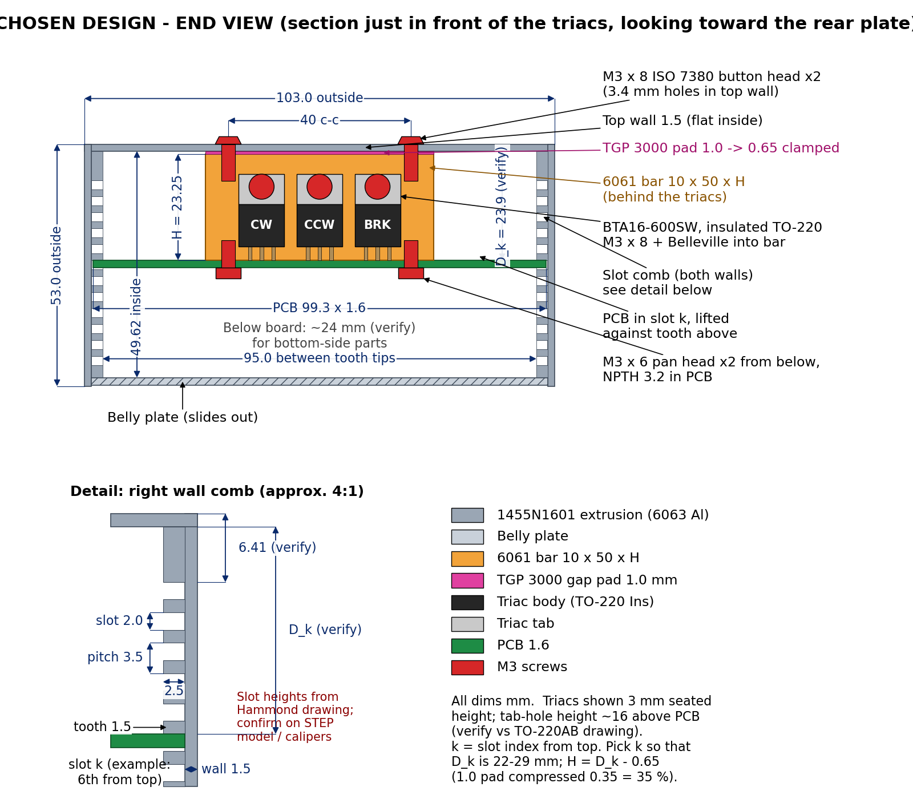
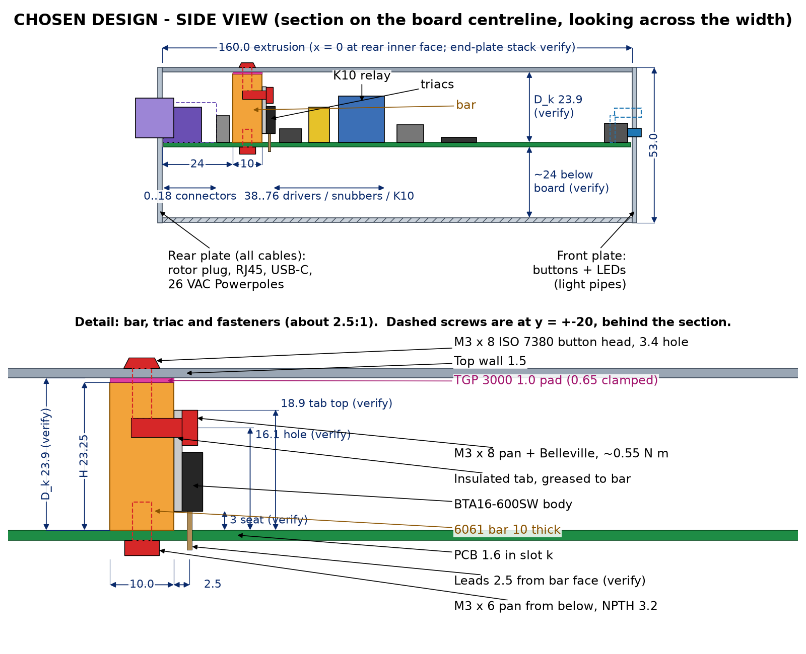
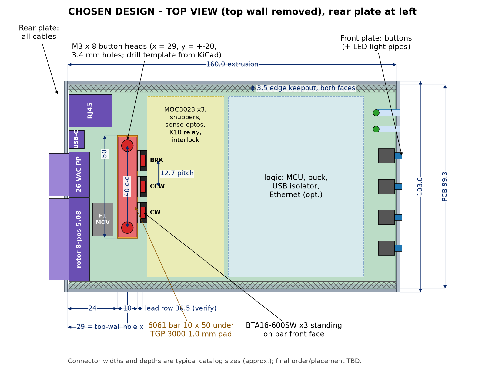

# Triac placement and thermal coupling to a Hammond 1455 extrusion

**Status (2026-10-11): DESIGN CHOSEN. This is the bar-on-board, top-wall-clamp approach in §3. A cheaper aluminum-angle variant is in §4. The other alternatives were rejected; §5 gives the reasons.**

Scope: the three power triacs (CW, CCW, Brake) from `v4-discrete-triac-change.md`, packaged in a Hammond 1455-series extruded aluminum box.

Packaging constraints:
- Front end plate carries the buttons and LEDs.
- Rear end plate carries every cable: rotor pigtail, 26 VAC Powerpoles, USB-C, RJ45. No separate 13.8 V lead (ADR 0018).
- No parts on the other faces and no internal wiring.

Written 2026-10-11; updated the same day with the chosen design.

Legend:
- **[V]** verified from a datasheet or drawing
- **[E]** engineering estimate, method stated
- **[U]** unverified: check before cutting metal or ordering
- **[M]** measure on the first build

---

## 1. Enclosure: Hammond 1455N1601 (160 × 103 × 53 mm)

Source: the Hammond drawing `hammfg.com/files/parts/pdf/1455N1601BK.pdf`. I downloaded it and read it at 400 dpi.

| Item | Value | Status |
|---|---|---|
| Outside L × W × H | 160.00 ±0.50 × 103.00 × 53.00 mm | [V] |
| Material | Extruded 6063 aluminum, clear or black anodized | [V] |
| Board width the extrusion is designed for | "Extrusion designed for 100 mm wide PC board". Slot-bottom to slot-bottom 100.00 ±0.51 mm. | [V] |
| Wall thickness (min) | 1.50 mm. 103 − 100 = 3, so the slot bottom is 1.5 mm from the outside face. | [V] |
| Internal height (inner top to inner floor) | 49.62 ±0.56 mm | [V] |
| Length | 160 ±0.5 mm | [V] |
| PCB slots | Each side wall has an internal **comb**: slots 2.00 mm wide (TYP), teeth 1.50 mm thick (TYP), so **3.5 mm pitch**, about 10 slots per side. | [V] dims, [E] count |
| Slot depth / tooth length | 2.50 mm, so tooth tips sit 4.0 mm from the outside face. Clear width between tooth tips ≈ 95.0 mm (the older drawing shows "95.00"). | [V]/[E] |
| First slot from inner top | 6.41 mm dimension on the drawing. I read it as top inner face to the first tooth/slot edge. | [U] |
| Exact height of each slot | Not dimensioned. Get Hammond's STEP model or measure with calipers. | [U] |
| Slot fit for a 1.6 mm board | Vertical: 2.0 mm slot − 1.6 mm board = **0.4 mm** nominal, **0.25–0.55 mm** with board thickness tolerance (±0.15). Lateral: slot bottoms 100.00 ±0.51 mm minus a 99.3 mm board = **≈0.2–1.2 mm** total side-to-side play, so engagement is ≥ 1.3 mm per side even when the board is shoved to one wall. | [V] slot/width; [E] board tol; [U] slot-width tolerance |
| Belly plate | The **bottom is the only removable (sliding) plate**. Top and both sides are **one piece**. Both end plates are removable. | [V] Hammond series text and drawing |
| End plates | 103 × 53 × 1.5 mm aluminum, 4 × #6 Taptite screws on a 95.02 × 45.00 mm pattern | [V] |

**Consequences for heat sinking:**
1. **The inside of the side walls is not flat; it is the slot comb.** A tab pressed against a side wall touches only the 1.5 mm tooth tips: 1.5/3.5 ≈ **43 % of its area**.
2. **The inside of the top wall is flat** (about 90 mm wide between the corner bosses) and is integral with both side walls. It is the best heat-sinking surface in the box.
3. **The floor is the belly plate.** Its sliding-rail joint to the extrusion is a poor, unspecified thermal path, and its outer face points down at the desk. It is the worst surface.

### Box-to-ambient thermal resistance [E]

Method: natural convection plus radiation over the surface, with the box treated as roughly isothermal.

- **Convection:** a vertical wall 53 mm tall at ΔT ≈ 20 K gives h ≈ 1.42 (ΔT/L)^0.25 ≈ 6.3 W/m²K. The top face gives about 6.5.
- **Radiation:** anodized aluminum has ε ≈ 0.8 [U], so h_r ≈ 4εσT³ ≈ 6 W/m²K.
- **Total:** h ≈ 12 W/m²K.
- **Area:** top 0.0165 + sides 0.0170 + ends 0.0109 + 50 % of the bottom (0.0082) ≈ 0.053 m².
  - That gives G ≈ 0.63 W/K, i.e. **R ≈ 1.6 °C/W** for an ideally isothermal box.
- **Isothermal check:** a 1.5 mm Al wall has fin parameter m = √(h/kt) ≈ 6 /m. Over 80 mm, efficiency is about 0.9, so the box is close to isothermal at these power levels.
- **Design value: 3 °C/W.** This allows for the end-plate and belly joints, the feet, and desk clutter. Expect 2 °C/W in practice. **[M]: check with a 5 W resistor test (§7).**

Thermal mass: about 0.3 kg of aluminum [U weight] × 900 J/kgK ≈ 270–300 J/K, so **τ ≈ 13–15 min**. A 60 s full rotation at the worst-case 7.9 W raises the box temperature by only about 1.6 °C. **Steady-state numbers only matter for a stuck-on or continuous-run fault.** **Firmware requirement: cap a single run at ≤ 120 s** (fault if exceeded).

---

## 2. Power and part data used

| Item | Value | Status |
|---|---|---|
| Triac (TO-220) | **BTA16-600SW**, insulated TO-220AB, tab isolation 2500 Vrms | [V] |
| Rth(j-c), TO-220AB Ins | **2.1 °C/W** (D²PAK and non-insulated TO-220AB: 1.2 °C/W) | [V] ST table |
| Vto / Rd at 125 °C | 0.85 V / 25 mΩ | [V] |
| Tj max | 125 °C | [V] |
| D²PAK alternative | T1635H-600G: 16 A, I_GT 35 mA, Rth(j-c) 1.2 °C/W, Tj 150 °C, **tab = A2 (MT2)**. **Marked obsolete by ST.** Current same-family D²PAK: **T1610-600G** (10 mA) or T1635-600G from the BTA16/T16 datasheet | [V] obsolete status; [U] T1610-600G stock |
| Worst-case dissipation (nameplate) | Brake 5 A: **4.5 W**. Motor 2.25 A: **1.85 W**. Only one direction triac plus the brake conduct together: **6.35 W** | [E] from Vto/Rd |
| Measured case (board note) | Brake ~2 A: 1.6 W. Motor 0.7 A: 0.55 W. **≈ 2.15 W** | [E] |
| Logic dissipation inside the box | ≈ 1.5 W (buck, MCU, LEDs, PoE/Ethernet PHY if fitted) | [E] |
| Design ambient | 40 °C worst shack, 25 °C typical | — |
| Thermal interface pad (chosen) | **Bergquist (Henkel) GAP PAD TGP 3000** (= GP3000S30), **1.0 mm (0.040")**. 3.0 W/m·K (ASTM D5470), >3000 VAC breakdown, Shore 00 30, fiberglass-reinforced (resists puncture and tear), −60…200 °C, tack on both sides with a reduced-tack top. Thermal impedance at 1.0 mm: 0.66 / 0.60 / 0.54 °C·in²/W at 10 / 20 / 30 % deflection. Sheet part number pattern GP3000S30-0.040-02-0816 (8 × 16 in) [U exact suffix]. | [V] material/thickness; [U] P/N suffix |
| Pad alternates | **TGP 3000ULM** (ultra-low modulus, non-reinforced, 1.0 mm: 0.55 / 0.49 / 0.43 °C·in²/W at 10/20/30 %). This is about 0.1 °C/W better here but tears more easily. Or a Laird Tflex-family ≈ 3 W/m·K pad at 1.0 mm [U: confirm the exact Laird part and its datasheet]. | [V] ULM; [U] Laird |

**MT2 net check against our plan (`v4-discrete-triac-change.md` §3):** the triacs switch the hot side, so MT2 (A2) of all three ties to the same post-relay `/26VAC` bus, and MT1 goes to `/Left`, `/Right`, `/Brake`. [V]
- A D²PAK's tab is MT2, so all three tabs are on **one net** and can share one copper island.
- That island is 26 VAC hot. It must be insulated from the enclosure, because the enclosure will normally be bonded to the cable shield / chassis.

---

## 3. CHOSEN DESIGN: triacs on a bar fixed to the PCB, bar clamped to the top wall

### Concept

- Three **BTA16-600SW** (insulated TO-220AB) stand vertically in a row at 12.7 mm pitch near the rear of the board.
  - Their leads are **soldered to the PCB**.
  - Each tab is **greased and bolted** to the front face of one aluminum **flat bar, 10 thick × 50 long × H tall** (6061).
- **The bar is screwed to the PCB from below (2 × M3).** Board, bar and triacs form one rigid unit.
  - **Rationale (yours):** vibration and handling then can't work the triac legs or solder joints. The leads never carry the bar's mass or any clamp load.
- One **1.0 mm compliant gap pad** sits on the bar's top face.
- **2 × M3 button-head screws through the top wall** pull the bar, and with it the board, up against the wall.
  - The board rises inside its slot float until the board's top face meets the upper face of the slot.
  - All height tolerance is taken up at **one interface**, the pad.
- The tabs are internally insulated (2500 Vrms) [V], so the bar, screws and box sit at chassis potential. No insulators or shoulder washers are needed.
- Why the top wall: it is the only flat inside face, and it is integral with both side walls. The sides are the slot comb and the bottom is the sliding belly plate (§1).

Drawings (mm; anything marked "(verify)" is not yet confirmed):

*End view, section just in front of the triacs, looking toward the rear plate.*
- The PCB sits in slot k, lifted against the tooth above.
- The bar (10 × 50 × H, H = D_k − 0.65) is held to the PCB by 2 × M3 from below.
- The 1.0 mm TGP 3000 pad (0.65 mm when clamped) is pulled against the flat top wall by 2 × M3 × 8 ISO 7380 button heads, 40 mm apart.
- Inset: the slot comb. Slots 2.0 mm, pitch 3.5 mm, 2.5 mm deep; first slot 6.41 mm below the inner top (verify).
- Example slot (6th from top): D_k ≈ 23.9 mm (verify), so H ≈ 23.25 mm, with about 24 mm left below the board.

*Side view, section on the board centreline.*
- Full 160 mm length, rear to front: rear plate and connectors (x = 0..18), bar (x = 24..34), drivers/snubbers/K10 relay, logic, then front-plate buttons and LED light pipes.
- Detail: each tab is greased and bolted to the bar with M3 × 8 + Belleville washer.
  - Tab hole ≈ 16.1 mm above the PCB, tab top ≈ 18.9 mm, seated 3 mm up, lead row 2.5 mm from the bar face. All four need verifying against the TO-220AB drawing.
- Dashed screws are the top-wall and bottom bar screws at y = ±20, behind the section plane.

*Top view, top wall removed, rear at left.*
- Connectors line the rear plate (sizes approximate), with F1/MOV beside the rotor block.
- Bar at x = 24..34, y = −25..+25.
- **Top-wall holes at x = 29, y = ±20 (Ø3.4)**, measured from the rear-plate inner face and the board centreline.
- Triacs at 12.7 mm pitch: CW, CCW, BRK going from −y to +y.
- Drivers zone at x = 38..76, then logic, then buttons/LEDs at the front.
- 3.5 mm keepout along both long edges.

### Tolerances and how they are absorbed

| Item | Value | Effect |
|---|---|---|
| Vertical slot float | 2.0 slot − 1.6 board = 0.4 nominal; **0.25–0.55** with board tolerance [V/E] | The screws use it: they lift the board until it stops against the upper slot face. This fixes the bar position relative to the wall. |
| Lateral play | Slot bottoms 100.00 ±0.51 vs 99.3 board → **≈0.2–1.2 total** [V/E] | None on the thermal path. The bar is ≥ 22 mm from either side wall. Engagement stays ≥ 1.3 mm per side. |
| Internal height | 49.62 ±0.56 [V] | Box-to-box D_k variation. The slot-to-top share of this tolerance isn't given [U]. Measure it (below). |
| Length | 160 ±0.5 [V] | Board ≤ 159 mm. Rear-plate/connector stack-up only. |
| Bar height H | Cut or mill to ±0.05 [E] | Small next to the pad's working range. |

**Pad compression budget (1.0 mm TGP 3000)**
- Clamped thickness = D_k − H, where D_k is measured with the board lifted against the upper slot face.
- Design point: **H = D_k − 0.65 mm**. The pad is then clamped to **0.65 mm**: a **0.35 mm (35 %) compression**.
- Working range: clamped thickness **≈0.50–0.85 mm (15–50 % deflection)** [E].
  - This tolerates about ±0.15 mm of box-to-box D_k variation plus the ±0.05 bar tolerance.
  - Check the datasheet's pressure-vs-deflection curve to confirm 50 % is acceptable for TGP 3000 [U].
- Clamp force is small: Shore 00 30 material over 500 mm². The board's hard stop sets the compression, not the screw torque.
- **Insertion clearance:**
  - Before the screws are tightened, the board rests low in its slot (by the 0.25–0.55 mm float).
  - Room above the bar is then 0.65 + float = **0.90–1.20 mm**, against a 1.0 mm pad.
  - At worst the pad drags about 0.1 mm over the ~30 mm of travel under the top wall. Put the reduced-tack side up.
  - If it drags hard, take 0.1 mm off H.

### Process: set H once, reuse it for every box

1. **Measure D_k on your actual box.**
   - Put a scrap 1.6 mm board (or the real PCB) in the chosen slot k and push it up against the upper slot face.
   - Measure from its top face to the inner top wall with a caliper depth rod at both ends and the middle.
   - Or take D_k from Hammond's STEP model, then confirm with calipers.
2. **Cut the bar to H = D_k − 0.65 mm** (±0.05) from 10 × 25 mm 6061 flat bar.
   - This requires D_k ≤ 25.6 mm. For a deeper slot, use 10 × 30 bar stock.
   - Example: D_k = 23.9 (verify) gives H = 23.25.
3. **Record H in the build notes and use it for every box.** Measure D_k on the next 2–3 boxes.
   - If any differs by more than ±0.15 mm, cut H for that box, or add or remove a 0.25 mm (0.010") TGP 3000 layer.
4. Choosing k: D_k must be ≥ ~21 mm (tallest triac point ≈ 19–19.5 mm, plus clearance) and ≤ ~29 mm, leaving room below the board for bottom-side parts.

### Thermal budget (series; the shared elements carry the sum of all triac power)

| Element | Per-triac °C/W | Shared °C/W | Basis |
|---|---|---|---|
| Rj-c, BTA16 Ins | 2.1 | | [V] |
| Tab → bar, grease, M3 at ~0.55 N·m | 0.4 | | [E]; typical greased TO-220 joint is 0.3–0.5 |
| Bar conduction, ~20 mm through a 10 × 50 section | | 0.2 | [E] |
| **Bar → top wall, 1.0 mm TGP 3000 clamped to 0.65 mm, 500 mm² (0.78 in²)** | | **0.7** | [E] datasheet 0.54 °C·in²/W at 30 % ÷ 0.78 in². Range 0.6 (50 %) to 0.8 (15 %). |
| Top-wall spreading into the box | | 0.5 | [E] |
| **Subtotal** | **2.5** | **1.4** | |
| Box → ambient | | 3.0 (design) / 2.0 (likely) | [E] §1 |

**Thermal penalty of the 1.0 mm pad vs 0.5 mm.**
- The 0.5 mm pad at ~0.35 mm clamped was ≈ 0.4 °C/W. The 1.0 mm pad adds **+0.3 °C/W** on the shared path.
- That is **+1.9 °C** on every triac at the 6.35 W worst case, and +0.6 °C at the measured currents.
- In exchange, the pad has a usable compression range about 3× wider, so one bar height covers box-to-box variation.

| Case | Box temperature | Brake Tj | Motor Tj |
|---|---|---|---|
| Worst, 40 °C, steady state (triacs 6.35 W + logic 1.5 W) | 40 + 7.85 × 3 = **63.6 °C** | 63.6 + 6.35 × 1.4 + 4.5 × 2.5 ≈ **84 °C** | ≈ **77 °C** |
| Measured currents, 40 °C (3.65 W total) | ≈ 51 °C | ≈ 58 °C | — |
| Measured currents, 25 °C | — | ≈ 43 °C | — |

- **41 °C margin** to Tj max (125 °C) at the worst case.
- A 60 s run at the worst case raises the box < 2 °C and the bar (~34 g, ~30 J/K) < 10 °C.
- With the **≤ 120 s firmware run cap**, steady state only matters for a stuck-on fault. The master relay and watchdog cover that case.

### Parts

| Part | Spec | Status |
|---|---|---|
| Bar | 6061-T6 flat bar 10 × 25 mm, 50 mm long, H = D_k − 0.65 (milled or filed flat). Tapped holes: 3 × M3 in the front face for the triacs (12.7 mm pitch, height to match the tab holes, 8 mm deep); 2 × M3 in the top face at ±20 mm, 10 mm deep; 2 × M3 in the bottom face at ±20 mm, 8 mm deep (≥ 5 mm of solid web between the top and bottom holes). Break the edges. | [E] |
| Pad | Bergquist GAP PAD TGP 3000, 1.0 mm (0.040"), die-cut or knife-cut 10 × 50 mm. Sticky side on the bar, reduced-tack side up. Alternate: TGP 3000ULM 1.0 mm. | [V] material; [U] P/N suffix |
| Triac screws | 3 × M3 × 8 pan head + flat washer + Belleville washer, ~0.55 N·m | [U] torque per ST mounting guidance |
| Top-wall screws | 2 × M3 × 8 ISO 7380 button head (1.65 mm head), black, through Ø3.4 holes. Thread engagement ≈ 8 − 1.5 − 0.65 ≈ 5.9 mm (~2d in 6061). | [E] |
| PCB-to-bar screws | 2 × M3 × 6 pan head from the PCB underside, through **non-plated** Ø3.2 holes with a ≥ 1 mm copper-free ring | [E] |
| Grease | Any thermal compound, thin film, tab to bar | — |

**Isolation and creepage.**
- The only AC copper near the bar is the triac pads and leads. Keep ≥ 1 mm from the bar footprint and screw holes; ≥ 2 mm is easy here.
- At 26 VAC this is about not shorting /26VAC to chassis. It is not a safety barrier.
- **Bond the box to logic GND / shield at one point** (the rear-plate lug), so an insulation fault blows F1 instead of leaving the box live.

### Assembly and service

1. **Bench assembly (board out of the box):**
   - Screw the bar to the PCB (2 × M3 from below).
   - Insert the triacs and bolt their tabs to the bar with grease.
   - **Solder the triacs last**, with the bar already fixed, so the leads are stress-free.
2. Stick the 1.0 mm pad on top of the bar (sticky side down).
3. Attach the rear plate to the rear connectors (one subassembly). The front plate stays on the extrusion.
4. **Slide the board in from the rear end** in slot k. The pad travels about 30 mm under the top wall with ~0–0.1 mm interference.
5. Screw the rear plate on.
6. **Drive the two top-wall M3 screws.** Snug them until the board stops against the upper slot face, then stop. The threads are in aluminum.

**Service:** remove the 2 top screws and the 4 rear-plate screws, then slide the board out with the bar, triacs and rear plate attached. The belly (bottom) plate never needs to come off for this. It is the only removable face of the extrusion besides the two end plates; the top and sides are one piece.

---

## 4. Cheaper alternative: 1 in aluminum angle instead of the machined bar

Use 1 × 1 × 1/8 in (25.4 × 25.4 × 3.2 mm) 6063 angle, 50 mm long, as an inverted L:
- The **horizontal leg is on top**, against the pad. That gives 25.4 × 50 = 1270 mm² of pad contact, 2.5× the bar's.
- The **vertical leg carries the triacs.**
- **Use nuts or inserts, not tapped threads.** 3.2 mm of 6063 gives only ~6 M3 threads.
  - Triacs: M3 screw + Belleville + nut behind the leg.
  - Top-wall screws: M3 self-clinching (PEM-type) nuts pressed into the top leg [U: part number for 3.2 mm Al], or rivnuts.
- **Keep it rigid to the board** (your rationale). The vertical leg's bottom edge stands on the PCB, so tie it down with 2 small PCB-mount right-angle brackets (Keystone-style, M3) bolted to the leg [U: part number].
- **Height is fixed at 25.4 mm**, so pick the slot to suit. You need D_k ≈ 25.4 + clamped pad thickness.
  - The estimated comb gives D_k ≈ 23.9 or 27.4 (verify). Neither fits a 1.0 mm pad.
  - With D_k ≈ 27.4 you have a 2.0 mm gap: use a 2.5 mm (0.100") TGP 3000 (~20 % deflection, ≈ +0.2 °C/W over the large area), or a 1.0 mm aluminum shim plus the 1.0 mm pad.
  - Compute this from the measured D_k.
- **Thermal [E]:** heat has to run up a thin leg to the corner.
  - 1/8 in leg: ≈ **+1.8 °C/W per triac** (≈ +1–2 °C/W range). The larger pad area saves ≈ 0.4 °C/W shared.
    - Net worst-case brake Tj ≈ 63.6 + 6.35 × 0.9 + 4.5 × 4.3 ≈ **89 °C** (vs 84 °C for the bar).
  - **3/16 in (4.8 mm) angle** brings the per-triac penalty to ≈ +1.2 °C/W, giving ≈ **86 °C**. That recovers most of the margin.
- **Cost and effort:** hardware-store stock, sawn to length, no milling or tapping. In exchange you need extra nuts/brackets and a fixed height.

---

## 5. Rejected options (kept for the record)

| Option | What it was | Why rejected |
|---|---|---|
| A1: triac tabs against a side wall, slide-in pad, no holes | TO-220s at a long board edge pressing on the comb tooth tips | The comb gives only ~43 % contact area (tooth tips). The ±0.6 mm lateral stack makes contact uncertain. ≈ 8 °C/W junction→box, ≈ 100 °C brake Tj if it touches at all. Eats about 35 mm of the long edge. |
| A2: side wall, screws through a tooth | Same as A1, clamped through the side wall into a bar | Thermally fine (≈ 81 °C). But: 3 visible screws on a side face; each tab hole must line up with a 1.5 mm tooth (needs ±0.5 mm seating height); the 3 screws must come out before the board slides. |
| B-no-hole: bar to top wall by interference only | Chosen layout but no top-wall screws, 1.0 mm pad at ~30 % interference | Pad drags ~30 mm on insertion. Contact isn't guaranteed at the tolerance extremes because there's no clamp to pull the board to its hard stop. ≈ +0.3 °C/W and unverifiable. |
| Bar fixed to the top wall, triacs not tied to the board | Bar screwed to the lid; triacs either flying-lead or soldered with the board floating | Vibration and differential movement load the triac leads and solder joints. This is the failure your rationale avoids. |
| C: D²PAK on PCB copper → via array → pad → spacer → belly plate | SMT triacs, heat down through vias to the floor | The belly plate's sliding-rail joint is the weakest path (≈ 4–4.5 °C/W, belly faces the desk). The tab is MT2 = 26 VAC hot, so the copper island needs puncture-proof insulation. The via array costs board area. The ST T1635H-600G is obsolete. The belly plate must slide in under an installed board. ≈ 90 °C brake Tj. |

---

## 6. Summary

| Option | Junction → box (brake triac) | Worst-case brake Tj @ 40 °C | Contact certainty | Visible fasteners | Status |
|---|---|---|---|---|---|
| **Bar on PCB → 1.0 mm pad → top wall, 2 screws** | **2.5 + 1.4 shared** | **~84 °C** | **High** | **2 on top** | **CHOSEN** |
| 1/8 in angle variant | ~4.3 + 0.9 shared | ~89 °C | High | 2 on top | Cheaper alternative |
| 3/16 in angle variant | ~3.7 + 0.9 shared | ~86 °C | High | 2 on top | Cheaper alternative |
| A1 side wall, slide-in pad | ~8 | ~100 °C if touching | Low | None | Rejected |
| A2 side wall, screw through tooth | ~3.8 | ~81 °C | High | 3 on a side | Rejected |
| B no-hole | ~2.5 + 1.7 | ~86 °C | Medium | None | Rejected |
| C D²PAK to belly | 3.8 + 0.6 + weak belly | ~90 °C | Medium-high | None | Rejected |

---

## 7. Bring-up thermal test [M]

1. Before the triacs exist: bolt a TO-220 power resistor (e.g. a 20–30 W TO-220 thick-film part, run at 5 W) to the bar in the brake position. Thermocouple the resistor tab and the top wall above the bar. Run 60 min at 25 °C ambient.
2. Expected: wall ≈ +10–15 °C; tab − wall ≤ 6.5 °C. If tab − wall > 8 °C, the pad isn't clamped. Recheck D_k − H with a feeler gauge, and check that the board reached its slot stop.
3. Repeat with 6.4 W split across two positions.
4. Record R(box→ambient) and use it in place of the 3 °C/W design value.
5. Firmware: confirm the ≤ 120 s single-run cap trips and latches a fault.

---

## 8. KiCad placement checklist

- **Board outline:** **99.3 ±0.1 mm wide.** Extrusion minimum is 99.49 mm, so ≥ 0.19 mm total clearance. At the 100.51 mm maximum, engagement is still ≥ 1.3 mm per side when shoved to one wall. Length ≤ 159 mm.
  - The rear-plate connectors define x = 0. The front buttons and LEDs project to the front plate holes.
- **Edge keepout (both long edges, both faces):** 3.5 mm. No parts, no exposed copper, and copper pulled back ≥ 0.5 mm from the edge.
- **Height keepouts:** top side ≤ D_k − 1 mm except the bar; bottom side ≤ (slot height above the floor) − 1 mm. Draw these as a user-layer note per slot choice [U until D_k is measured].
- **Bar footprint "AL_BAR_10x50":**
  - Courtyard 10.5 × 50.5 mm.
  - 2 × NPTH Ø3.2 at ±20 mm from the bar centre.
  - No copper under the bar on F.Cu, or solder-mask-covered GND only.
  - ≥ 1 mm copper-free ring around the holes; silkscreen outline.
- **Triac row:**
  - Three TO-220 vertical footprints at **12.7 mm pitch**, lead row **2.5 mm in front of the bar face** [U: check the TO-220AB drawing].
  - Pin order A1 (MT1) / A2 (MT2) / G per ST pins 1-2-3 [U].
- **Power pours (4-layer, 2 oz):**
  - /26VAC from J(26VAC) → F1 → K10 → the three MT2 pads as a ≥ 5 mm pour.
  - /Left, /Right, /Brake as ≥ 2.5 mm traces or pours; keep the brake loop shortest.
  - Keep the logic GND plane away from the AC section by ≥ 2 mm.
- **Top-wall drill template:** a Fab-layer drawing with the 2 top screw positions in enclosure coordinates: **x = 29 mm from the rear-plate inner face, y = ±20 mm from the centreline, Ø3.4.** Print it 1:1 to mark the top wall.
- **Clearances:** AC net to AC net ≥ 1 mm; AC to logic ≥ 2 mm; AC copper to the bar/NPTH ≥ 1 mm.
- **Mounting holes:** none needed; the slots plus the bar screws locate the board.

---

## 9. Unverified items to close

- **D_k for the chosen slot on your box** (calipers or Hammond STEP), and its box-to-box spread. This sets H.
- The meaning of the 6.41 mm dimension; slot-width tolerance.
- TGP 3000 maximum recommended deflection (pressure-vs-deflection curve) and the exact 1.0 mm sheet part number. Laird equivalent if preferred.
- TO-220AB tab-hole height, seating height and lead-row offset from the tab back face.
- TO-220 mounting torque (ST guidance).
- Box mass and emissivity; measured R(box→ambient) per §7.
- For the angle variant: PEM nut and PCB bracket part numbers.
